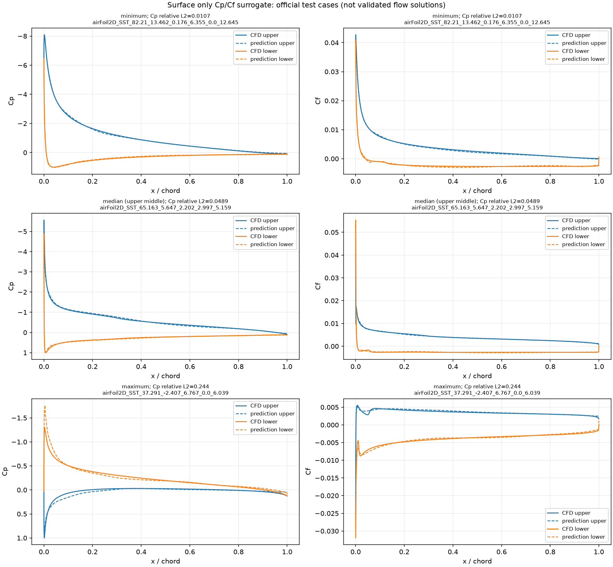
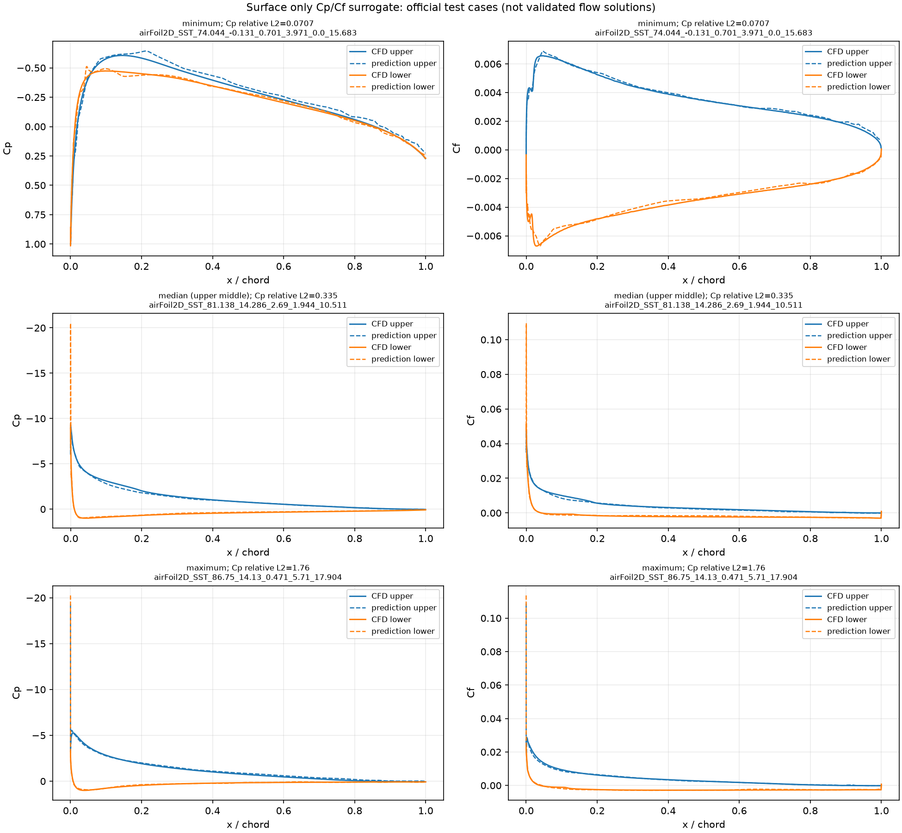
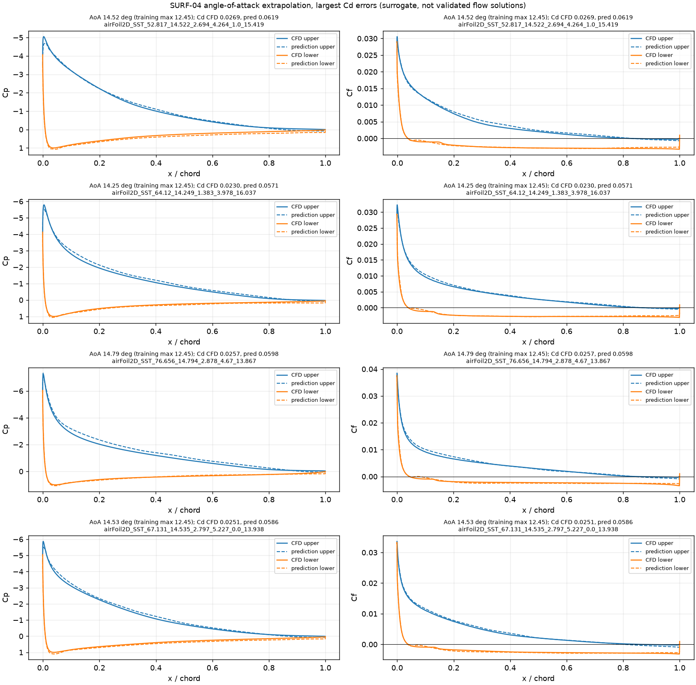

# 表面だけの Cp・Cf 予測（計画）

作成日: 2026-10-29。状態: **SURF-01〜04・SURF-06 は実行済み（2026-10-30〜31。SURF-02・06 は乱数の種を変えて各3回）。ほかは未実行**。コードは `surfcpcf/`（[PR #1](https://github.com/pandorobo11/transolver/pull/1)、main の commit `1c810f1`）。

## 目的

Mac mini（Apple M5 Pro、メモリ24GB、PyTorch MPS）で Transolver の扱いに慣れるため、AirfRANS の翼表面の点だけを使い、表面の圧力係数 Cp と表面摩擦係数 Cf を予測する。予測した Cp・Cf を翼面に沿って積分して Cl・Cd を求め、CFD の値と比べる。

体積場（約18万点/ケース）を使わないので、メモリと時間の負担が小さい。データの扱い、MPS での動作、学習と評価の流れを一通り作ることを優先する。

あわせて次の2つを調べる。

- 比較用の簡単なモデルと比べ、Transolver の点どうしの情報のやり取り（Physics-Attention）が精度に効いているか。
- Physics-Attention が翼面の点をどのようなまとまり（スライス）に分けているか。

関連する計画: 環境の検証は [20261029-standard-benchmark-repro](../20261029-standard-benchmark-repro/README.md)、体積場も学習させた場合との比較は [20261029-volume-vs-surface](../20261029-volume-vs-surface/README.md)。

## 位置づけ

- **独自の設定であり、論文の数値とは比較できない。** Transolver 論文の AirfRANS の結果は体積場と表面場を同時に学習した場合の指標（体積場・表面場の誤差、Cl・Cd の誤差、順位相関）で、本計画とは入力も目標も異なる。結果には「表面のみ、Cp・Cf」と明記する。
- データの分割は AirfRANS 公式の分割（`scarce`、`full`、`reynolds`、`aoa`）をそのまま使う。
- 予測は CFD の代わりになる検証済みの解ではない。学習範囲外（`reynolds`・`aoa` の外挿、学習にない形状）の結果は外挿として区別して示す。

## 取得するもの

| 対象 | 取得元 | 版 | ライセンス |
|---|---|---|---|
| Transolver 公式リポジトリ | `https://github.com/thuml/Transolver`（`Airfoil-Design-AirfRANS/` を使う） | commit `75e0f6764380`（2026-02-26 時点の HEAD） | MIT |
| `airfrans` ライブラリ | PyPI `airfrans`（ソースは `https://github.com/Extrality/airfrans_lib`） | 0.1.5.1 | GitHub の判定は MIT、README は ODbL-1.0 と記載 |
| AirfRANS データセット | `https://data.isir.upmc.fr/extrality/NeurIPS_2022/Dataset.zip`（`airfrans.dataset.download(root, OpenFOAM=False)` が使う URL） | 取得時に記録 | 取得時に確認して記録する（ODbL-1.0 の見込み） |

データセットの zip は 10,029,067,577 バイト（約10.0GB。2026-10-29 にダウンロード元の応答ヘッダで確認）。展開後はさらに大きくなる。

置き場所: リポジトリは `external/Transolver/`、データセットは `data/airfrans/`。どちらも Git 管理外。

## 正解値の作り方

AirfRANS の各ケースのファイルにある場は U、p、nut と法線で、壁面せん断応力と Cf は入っていない。`airfrans` の `Simulation.wallshearstress(reference=True)` が、CFD の速度場の勾配から表面の節点の τw = −2ν·S·n を計算する（`src/airfrans/simulation.py`）。公式の Cl・Cd の計算（`force_coefficient`）も、この τw と表面の p を積分している。

前処理でケースごとに次を1回だけ計算し、`data/airfrans_surface/` に保存する。

| 量 | 定義 |
|---|---|
| 表面の点 | `Simulation.surface`（U の x 成分が0の節点） |
| Cp | p / (½U∞²)。p は密度で割った圧力（m²/s²） |
| Cf | (τw · t) / (½U∞²)。t は法線 n を +90° 回転した単位接線 (−n_y, n_x)。符号付き。10月30日の確認で、vtp の法線は98%の点で翼の内向きだった。このため t は上面では下流、下面では上流を向き、付着流の Cf は上面で正、下面で負になる。剥離は、上面では Cf が負になる区間、下面では正になる区間として現れる |
| 力の積分に使う量 | 翼面の要素の長さと法線（`Simulation.airfoil` から） |

ν は `airfrans` の既定（T = 298.15 K）に合わせる。

## 共通の条件

| 項目 | 設定 |
|---|---|
| データ | AirfRANS、公式分割。表面の点を全点使う（間引かない） |
| 入力（6成分/点） | 位置 (x, y)、一様流の速度 (2成分)、法線 (2成分)。表面では壁からの距離が常に0なので除く |
| 目標（2成分/点） | Cp、Cf |
| 正規化 | 入力・目標とも学習データの平均と標準偏差で成分ごとに正規化する（Cf は Cp より桁が小さいため） |
| 損失 | 正規化した Cp と Cf の MSE の平均 |
| Transolver | 公式 `models/Transolver.py`。公式 `main.py` と同じく入力の全成分を space_dim に渡す（space_dim = 6、fun_dim = 0、out_dim = 2）。頭数8、mlp_ratio 2 は公式どおり。`unified_pos` は表面の点で意味を持つか確認してから決める |
| 点ごとの MLP | 入力・目標・正規化・損失は Transolver と同じ。各点を独立に予測し、点どうしの情報のやり取りがない。パラメータ数を Transolver と同程度にそろえる |
| パラメータ回帰 | ケースごとに1回の予測。入力は一様流の速度の大きさ、迎角、NACA のパラメータ（ケース名から読む。4桁系と5桁系で個数が違うので、揃え方は前処理で決める）。目標は CFD の Cl・Cd（`force_coefficient(reference=True)`）。全結合の小さな MLP |
| 学習 | バッチサイズ1（1ケース）、Adam、学習率 1e-3、OneCycleLR（公式 `train.py` と同じ） |
| 装置 | `mps`（使えなければ `cpu`）。`.cuda()` の直書きは置き換える。`PYTORCH_ENABLE_MPS_FALLBACK=1` を使ったかを記録する |
| 精度 | fp32 |

## 実行する学習（計画）

実行した学習は「実行した学習」の節に、計画と同じ実行IDで載せる。

| 実行ID | モデル | タスク | 学習ケース数 | 層数 | 隠れ次元 | スライス数 | エポック数 | 目的 |
|---|---|---|---|---|---|---|---|---|
| SURF-01 | Transolver | `scarce` | 200 | 5 | 128 | 32 | 200 | 動作確認。時間とメモリを測る |
| SURF-02 | Transolver | `full` | 800 | 5 | 128 | 32 | 200 | データ量の効果 |
| SURF-03 | Transolver | `reynolds` | 公式分割 | 5 | 128 | 32 | 200 | レイノルズ数の外挿 |
| SURF-04 | Transolver | `aoa` | 公式分割 | 5 | 128 | 32 | 200 | 迎角の外挿 |
| SURF-05 | 点ごとの MLP | `scarce` | 200 | 未定 | 未定 | — | 200 | SURF-01 との比較 |
| SURF-06 | 点ごとの MLP | `full` | 800 | 未定 | 未定 | — | 200 | SURF-02 との比較 |
| SURF-07 | 点ごとの MLP | `reynolds` | 公式分割 | 未定 | 未定 | — | 200 | SURF-03 との比較 |
| SURF-08 | 点ごとの MLP | `aoa` | 公式分割 | 未定 | 未定 | — | 200 | SURF-04 との比較 |
| SURF-09 | パラメータ回帰 | `scarce` | 200 | 未定 | 未定 | — | 未定 | SURF-01 の Cl・Cd との比較 |
| SURF-10 | パラメータ回帰 | `full` | 800 | 未定 | 未定 | — | 未定 | SURF-02 の Cl・Cd との比較 |
| SURF-11 | パラメータ回帰 | `reynolds` | 公式分割 | 未定 | 未定 | — | 未定 | SURF-03 の Cl・Cd との比較 |
| SURF-12 | パラメータ回帰 | `aoa` | 公式分割 | 未定 | 未定 | — | 未定 | SURF-04 の Cl・Cd との比較 |

Transolver の大きさとエポック数は公式の AirfRANS 設定（層数8、隠れ次元256、398エポック）より小さい。SURF-01 の結果を見て見直す。比較用モデルの「未定」は、SURF-01 の設定が決まってからパラメータ数をそろえて決める。テストは `scarce` と `full` が同じ200ケースを使う。

## 実行した学習

| 実行ID | 状態 | モデル | タスク | 学習ケース数 | 層数 | 隠れ次元 | スライス数 | エポック数 | 開始 |
|---|---|---|---|---|---|---|---|---|---|
| SURF-01 | 学習と評価が完了 | Transolver | `scarce` | 180（200 から公式どおり1割を検証に回す） | 5 | 128 | 32 | 200 | 2026-10-30 20:04 |
| SURF-02 | 学習と評価が完了 | Transolver | `full` | 720（800 から1割を検証に回す） | 5 | 128 | 32 | 200 | 2026-10-30 22:19 |
| SURF-06 | 学習と評価が完了 | 点ごとの MLP | `full` | 720（同上） | 5（隠れ層） | 490 | — | 200 | 2026-10-30 23:14 |
| SURF-02-s1 | 学習と評価が完了 | Transolver | `full` | 720 | 5 | 128 | 32 | 200（種1） | 2026-10-30 23:37 |
| SURF-06-s1 | 学習と評価が完了 | 点ごとの MLP | `full` | 720 | 5（隠れ層） | 490 | — | 200（種1） | 2026-10-31 00:27 |
| SURF-02-s2 | 学習と評価が完了 | Transolver | `full` | 720 | 5 | 128 | 32 | 200（種2） | 2026-10-31 00:34 |
| SURF-06-s2 | 学習と評価が完了 | 点ごとの MLP | `full` | 720 | 5（隠れ層） | 490 | — | 200（種2） | 2026-10-31 01:24 |
| SURF-03 | 学習と評価が完了 | Transolver | `reynolds` | 454（504 から1割を検証に回す） | 5 | 128 | 32 | 200 | 2026-10-31 07:50 |
| SURF-04 | 学習と評価が完了 | Transolver | `aoa` | 724（804 から1割を検証に回す） | 5 | 128 | 32 | 200 | 2026-10-31 08:22 |

共通の条件は上の表のとおり。`unified_pos` は公式と同じ1にした（正規化前の座標から格子までの距離を特徴に加える）。乱数の種は0。テストは `full_test` の200ケース、表面の全点。

### 学習前の確認の結果（10月30日、`scarce_train` と `full_test` の400ケース）

| 確認 | 結果 |
|---|---|
| 1. 表面の点数、前処理の時間 | 1ケース 858〜1165点（平均1008）。前処理は1ケース平均0.37秒、400ケースで149秒 |
| 2. 自作の積分と `force_coefficient(reference=True)` | 6成分とも最大相対差 2e-14 以下で一致。要素の法線は vtp の要素の値ではなく、点の法線を要素に移した値（`airfoil.ptc()`）を使う必要があった（そのままだと Cd の圧力成分で 2.7e-3 ずれる） |
| 3. τw の法線成分 | 接線成分に対する大きさ（L2 ノルムの比）は中央値 0.0063、最大 0.027。法線成分を捨てると Cd が最大 2.6e-4、Cl が最大 4.1e-5（相対）ずれる |
| 4. 法線の向き、Cf の符号 | 法線は98%の点で翼の内向き。上面（前縁から5%を除く）の Cf は96%の点で正 |
| 5. MPS での動作 | `PYTORCH_ENABLE_MPS_FALLBACK` なしで順・逆伝播が通った |

### SURF-01 の結果

**表面のみ、Cp・Cf の独自の設定。論文の数値とは比較できない。** 縮小したモデル（公式は隠れ次元256、8層、398エポック）。テスト200ケースは、翼型のパラメータの組がすべて学習データにない。レイノルズ数が学習範囲外のケースが3、迎角が学習範囲外のケースが2ある（外挿）。値は [SURF-01-metrics.json](SURF-01-metrics.json)。

| 指標 | 平均 | 中央値 |
|---|---|---|
| Cp の相対L2誤差 | 0.209 | 0.170 |
| Cf の相対L2誤差 | 0.175 | 0.139 |
| Cl の相対誤差 | 0.486 | 0.145 |
| Cd の相対誤差 | 1.13 | 0.888 |
| Cd の圧力成分の相対誤差 | 3.55 | 2.38 |
| Cd の摩擦成分の相対誤差 | 0.049 | 0.035 |

順位相関（Spearman）: Cl 0.981、Cd −0.044。

同じテスト200ケースでの VOL-01（体積場も学習した公式コード、同じ大きさのモデルと200エポック）との比較:

| 指標（中央値） | SURF-01 | VOL-01 |
|---|---|---|
| Cl の相対誤差 | 0.145 | 0.093 |
| Cl の順位相関 | 0.981 | 0.980 |
| Cd の相対誤差 | 0.888 | 23.1 |
| Cd の摩擦成分の相対誤差 | 0.035 | 約35（予測が正解の約36倍） |
| Cd の圧力成分の相対誤差 | 2.38 | 2.62 |
| Cd の順位相関 | −0.044 | −0.027 |

VOL-01 の値は [VOL-01 の結果](../20261029-volume-vs-surface/README.md#vol-01-の結果)から。VOL-01 は全点を乱数で間引いて推論しており、評価の手順が同じではない。どちらも学習1回。

わかったこと:

- Cf を直接予測すると、Cd の摩擦成分は中央値 3.5% の誤差で求まる。体積場の速度の勾配から求めた VOL-01（約36倍）の問題は、表面だけのモデルでは起きない。
- Cd 全体はまだ予測できていない。誤差の大部分は圧力成分から来ており、その誤差は VOL-01 と同程度。Cd の圧力成分は大きな圧力の力の差として残る小さな量なので、Cp の誤差（相対L2で約17%）がそのまま大きく出る。
- Cl は、SURF-01 のほうが VOL-01 より誤差がやや大きい（中央値 0.145 と 0.093）。順位相関は同程度。
- 学習の損失は最後に 0.009 まで下がった一方、検証の MSE は Cp 0.024、Cf 0.033 で、過学習の傾向がある。学習データは180ケース。

学習の途中の検証の MSE（正規化後、検証20ケース）:

| エポック | 学習の損失 | 検証 Cp | 検証 Cf |
|---|---|---|---|
| 1 | 0.941 | 0.621 | 0.592 |
| 50 | 0.479 | 0.378 | 0.256 |
| 100 | 0.129 | 0.0740 | 0.0697 |
| 150 | 0.0329 | 0.0537 | 0.0474 |
| 200 | 0.00914 | 0.0244 | 0.0330 |

Cp の相対L2誤差が最小・中央・最大のテストケースの Cp・Cf 分布（破線が予測）:


誤差が最大のケース（迎角 −1.9°、後縁が反った5桁系）では、下面の負圧を大きく過大に予測している。

### 時間とメモリ（SURF-01）

| 項目 | 値 |
|---|---|
| 1エポックの時間（学習と、10エポックごとの検証） | 平均3.7秒 |
| 学習全体（データの読み込みを含む） | 739秒（約12分） |
| 評価（テスト200ケースの推論と積分） | 1.6秒 |
| MPS が確保したメモリ | 0.17 GiB |
| プロセスのピークメモリ | 1.6 GB |
| `PYTORCH_ENABLE_MPS_FALLBACK` | 未設定 |
| パラメータ数 | 967,754 |

参考: 2エポックの試運転では、1エポックが MPS で3.7秒、CPU で2.3秒だった。1ケース約1000点と小さいので、CPU のほうが速い。

### SURF-02 の結果

SURF-01 と同じ設定で、学習データだけを `full`（720ケース）に増やした。テストは同じ `full_test` の200ケース。**表面のみの独自の設定で、論文の数値とは比較できない。縮小したモデル。** 学習データの範囲は、レイノルズ数 2.02×10⁶〜6.04×10⁶、迎角 −4.9°〜14.9°。テストのうちレイノルズ数の外挿は0ケース、迎角の外挿は1ケース。翼型のパラメータの組は200ケースすべてが学習データにない。値は [SURF-02-metrics.json](SURF-02-metrics.json)。

| 指標（中央値。括弧内は平均） | SURF-01（`scarce`） | SURF-02（`full`） |
|---|---|---|
| Cp の相対L2誤差 | 0.170（0.209） | 0.049（0.055） |
| Cf の相対L2誤差 | 0.139（0.175） | 0.051（0.056） |
| Cl の相対誤差 | 0.145（0.486） | 0.033（0.074） |
| Cd の相対誤差 | 0.888（1.13） | 0.191（0.304） |
| Cd の圧力成分の相対誤差 | 2.38（3.55） | 0.634（0.845） |
| Cd の摩擦成分の相対誤差 | 0.035（0.049） | 0.014（0.018） |
| Cl の順位相関 | 0.981 | 0.999 |
| Cd の順位相関 | −0.044 | 0.470 |

わかったこと:

- 学習データを4倍にすると、すべての指標が大きく良くなった。Cp・Cf の誤差は約3分の1、Cl の誤差は約4分の1になった。
- Cd も予測できるようになり始めた（中央値 19%、順位相関 0.47）。それでも誤差の大部分は圧力成分から来ており、圧力成分の誤差は中央値 63% と大きい。Cd の精度をさらに上げるには、圧力抵抗の精度が鍵になる。
- 検証の MSE は最後に Cp 0.0023、Cf 0.0061（学習の損失 0.00075）で、SURF-01 より過学習の差は縮まった。
- `full` での体積場のモデル（VOL-02）はまだ学習していないので、同じデータ量での体積場のモデルとの比較はまだない。

学習の途中の検証の MSE（正規化後、検証80ケース）:

| エポック | 学習の損失 | 検証 Cp | 検証 Cf |
|---|---|---|---|
| 1 | 0.741 | 0.525 | 0.550 |
| 50 | 0.107 | 0.0396 | 0.0628 |
| 100 | 0.0229 | 0.00990 | 0.0216 |
| 150 | 0.00391 | 0.00417 | 0.00984 |
| 200 | 0.00075 | 0.00232 | 0.00610 |

Cp の相対L2誤差が最小・中央・最大のテストケース（破線が予測）:



時間とメモリ（SURF-02）: 1エポック平均14.8秒、学習全体 2,961秒（約49分）、評価 2.0秒、MPS が確保したメモリ 0.18 GiB、プロセスのピークメモリ 2.8 GB、`PYTORCH_ENABLE_MPS_FALLBACK` は未設定。前処理は `full_train` の残り600ケースに229秒かかった。全1000ケースで学習前の確認2をやり直し、最大相対差は 1.7e-13 だった。

### SURF-06 の結果（点ごとの MLP）

SURF-02 と同じデータ、正規化、損失、最適化（Adam、OneCycleLR、200エポック、乱数の種0）で、Transolver の代わりに点ごとの MLP を学習した。MLP は各点の入力6成分（位置、一様流の速度、法線）だけから、その点の Cp・Cf を予測する。翼のほかの点の情報は使わない。隠れ層の幅490・5層・GELU で、パラメータ数は 966,772（SURF-02 の Transolver は 967,754）。コードは [PR #2](https://github.com/pandorobo11/transolver/pull/2)（commit `564cce8`）の `--model mlp`。値は [SURF-06-metrics.json](SURF-06-metrics.json)。**表面のみの独自の設定で、論文の数値とは比較できない。**

| 指標（中央値。括弧内は平均） | SURF-02（Transolver） | SURF-06（点ごとの MLP） |
|---|---|---|
| Cp の相対L2誤差 | 0.049（0.055） | 0.335（0.383） |
| Cf の相対L2誤差 | 0.051（0.056） | 0.349（0.395） |
| Cl の相対誤差 | 0.033（0.074） | 0.065（0.154） |
| Cd の相対誤差 | 0.191（0.304） | 0.570（0.703） |
| Cd の圧力成分の相対誤差 | 0.634（0.845） | 1.76（2.05） |
| Cd の摩擦成分の相対誤差 | 0.014（0.018） | 0.017（0.027） |
| Cl の順位相関 | 0.999 | 0.994 |
| Cd の順位相関 | 0.470 | 0.067 |

前縁の近くを除いた誤差（[le_error_split.py](le_error_split.py) で、保存したモデルからテスト200ケースを予測し直して計算。前縁の近く = x が翼の最小の x から翼弦の2%以内の点）:

| 相対L2誤差（中央値） | SURF-02（Transolver） | SURF-06（点ごとの MLP） |
|---|---|---|
| Cp、全点 | 0.049 | 0.335 |
| Cp、前縁の近くを除く | 0.068 | 0.111 |
| Cf、全点 | 0.051 | 0.349 |
| Cf、前縁の近くを除く | 0.060 | 0.073 |
| Cp の誤差の二乗和のうち、前縁の近くの点が占める割合 | 48% | 97% |

わかったこと:

- 同じパラメータ数で、Transolver は点ごとの MLP より、すべての指標で誤差が小さい。Cl の誤差は約半分、Cd の誤差は約3分の1。
- 差の大部分は前縁の近くで生じている。MLP は前縁の負圧のピークを大きく外し（代表ケースでは CFD の Cp −5〜−10 に対し約 −20）、Cp の誤差の97%が前縁の近く（翼弦の2%）の点に集まる。前縁の近くを除くと、MLP の Cp の誤差は Transolver の約1.6倍、Cf は約1.2倍まで縮まる。前縁の負圧のピークの高さは翼全体の形と迎角で決まるので、点どうしの情報のやり取りがない MLP では予測しにくいと見込む。
- MLP は過学習している。検証の MSE はエポック50の Cp 0.147、Cf 0.155 が最小で、その後は上がり、最後は Cp 0.234、Cf 0.194 になった（学習の損失は 0.048 まで下がる）。早めに止めても、検証の MSE は Transolver の最後の値（Cp 0.0023、Cf 0.0061）より数十倍大きい。
- 学習1回ずつの比較で、乱数による揺れはまだ見ていない。

学習の途中の検証の MSE（正規化後、検証80ケース）:

| エポック | 学習の損失 | 検証 Cp | 検証 Cf |
|---|---|---|---|
| 1 | 0.586 | 0.362 | 0.317 |
| 50 | 0.228 | 0.147 | 0.155 |
| 100 | 0.172 | 0.161 | 0.152 |
| 150 | 0.102 | 0.217 | 0.174 |
| 200 | 0.0484 | 0.234 | 0.194 |

Cp の相対L2誤差が最小・中央・最大のテストケース（破線が予測）:



時間とメモリ（SURF-06）: 1エポック平均2.2秒、学習全体 449秒（約7.5分）、評価 1.1秒、MPS が確保したメモリ 0.055 GiB、プロセスのピークメモリ 1.4 GB、`PYTORCH_ENABLE_MPS_FALLBACK` は未設定。

### 乱数の種による揺れ

SURF-02 と SURF-06 を、乱数の種だけを1・2に変えて学習し直した（実行ID の `-s1`、`-s2`。元の実行は種0）。種は重みの初期値と学習ケースの順番に効く。夜間に1つずつ順番に実行し、同時にほかの学習は走らせていない。コードは PR #2 のマージ後（main の commit `9e26fde`）。

| 指標（テスト200ケースの中央値） | SURF-02 種0 / 1 / 2 | 平均 ± 標準偏差 | SURF-06 種0 / 1 / 2 | 平均 ± 標準偏差 |
|---|---|---|---|---|
| Cp の相対L2誤差 | 0.049 / 0.039 / 0.045 | 0.044 ± 0.005 | 0.335 / 0.334 / 0.321 | 0.330 ± 0.008 |
| Cf の相対L2誤差 | 0.051 / 0.047 / 0.045 | 0.047 ± 0.003 | 0.349 / 0.353 / 0.354 | 0.352 ± 0.002 |
| Cl の相対誤差 | 0.033 / 0.028 / 0.032 | 0.031 ± 0.003 | 0.065 / 0.063 / 0.059 | 0.062 ± 0.003 |
| Cd の相対誤差 | 0.191 / 0.152 / 0.211 | 0.18 ± 0.03 | 0.570 / 0.603 / 0.571 | 0.58 ± 0.02 |
| Cd の圧力成分の相対誤差 | 0.634 / 0.486 / 0.584 | 0.57 ± 0.08 | 1.76 / 1.83 / 1.71 | 1.77 ± 0.06 |
| Cd の摩擦成分の相対誤差 | 0.014 / 0.009 / 0.013 | 0.012 ± 0.003 | 0.017 / 0.020 / 0.019 | 0.019 ± 0.001 |
| Cl の順位相関 | 0.999 / 0.998 / 0.998 | 0.998 | 0.994 / 0.995 / 0.994 | 0.994 |
| Cd の順位相関 | 0.47 / 0.54 / 0.43 | 0.48 ± 0.06 | 0.07 / −0.03 / −0.05 | 0.00 ± 0.06 |

Transolver と点ごとの MLP の差は、すべての指標で種による揺れよりずっと大きい。SURF-06 で述べた比較の結論は、種を変えても変わらない。学習の時間も種によらずほぼ同じだった（SURF-02 は 2,960〜2,982秒、SURF-06 は448秒）。

体積場も学習した公式コード（VOL-02、同じデータと大きさ）との比較は、[体積場の記録の VOL-02 の結果](../20261029-volume-vs-surface/README.md#表面だけのモデルsurf-02との比較)にある。Cl の誤差は SURF-02 のほうが小さく（中央値 0.031 と 0.052）、Cd は VOL-02 では摩擦成分が正解の30倍になり予測できない。

### SURF-03・SURF-04 の結果（外挿）

SURF-02 と同じ設定（Transolver、隠れ次元128、5層、200エポック、種0）で、公式の外挿のタスクを学習した。**テストのケースはすべて学習範囲の外にある（外挿）。** 表面のみの独自の設定で、論文の数値とは比較できない。値は [SURF-03-metrics.json](SURF-03-metrics.json)、[SURF-04-metrics.json](SURF-04-metrics.json)。

| 実行ID | タスク | 学習データの範囲 | テストの範囲 | テストのケース数 |
|---|---|---|---|---|
| SURF-03 | `reynolds` | Re 3.02×10⁶〜5.03×10⁶ | Re 2.02×10⁶〜3.01×10⁶（254ケース）と 5.04×10⁶〜6.04×10⁶（242ケース） | 496 |
| SURF-04 | `aoa` | 迎角 −2.48°〜12.45° | 迎角 −4.94°〜−2.51°（111ケース）と 12.51°〜14.93°（85ケース） | 196 |

レイノルズ数は翼弦長1、`airfrans` の動粘性係数（298.15 K）で計算した。翼型のパラメータの組は、どちらもテストの全ケースが学習データにない。

| 指標（中央値） | SURF-02（内挿、参考） | SURF-03 全体 | SURF-04 全体 |
|---|---|---|---|
| Cp の相対L2誤差 | 0.049 | 0.094 | 0.093 |
| Cf の相対L2誤差 | 0.051 | 0.082 | 0.085 |
| Cl の相対誤差 | 0.033 | 0.088 | 0.090 |
| Cd の相対誤差 | 0.191 | 0.393 | 0.335 |
| Cd の摩擦成分の相対誤差 | 0.014 | 0.037 | 0.020 |
| Cl の順位相関 | 0.999 | 0.993 | 0.977 |
| Cd の順位相関 | 0.470 | 0.459 | 0.824 |

外れた側ごとの誤差（テストのケースを学習範囲より下と上に分けた。Cl が0に近いケースで相対誤差が大きくなるので、誤差の絶対値も示す）:

| 区分 | ケース数 | Cp の相対L2誤差 | Cl の相対誤差 | Cl の誤差の絶対値 | Cd の誤差の絶対値（正解の Cd） |
|---|---|---|---|---|---|
| SURF-02 内挿（参考） | 200 | 0.049 | 0.033 | 0.018 | 0.0022（0.0111） |
| SURF-03 Re が低い側 | 254 | 0.121 | 0.113 | 0.072 | 0.0051（0.0117） |
| SURF-03 Re が高い側 | 242 | 0.072 | 0.049 | 0.035 | 0.0043（0.0102） |
| SURF-04 迎角が低い側 | 111 | 0.134 | 0.210 | 0.044 | 0.0027（0.0092） |
| SURF-04 迎角が高い側 | 85 | 0.044 | 0.037 | 0.049 | 0.0134（0.0226） |

すべて中央値。正解の Cl・Cd は各区分の中央値（Cl は絶対値）。集計は [extrap_split.py](extrap_split.py)（`python extrap_split.py data/airfrans_surface results/surface/SURF-03 re` など）。

学習範囲からの離れ方（範囲の幅に対する割合）で分けた SURF-03 の誤差（中央値）: 0〜10% で Cp 0.066・Cl 0.045、10〜20% で 0.082・0.071、20〜30% で 0.089・0.070、30% 以上で 0.146・0.134。

わかったこと:

- 外挿では、内挿（SURF-02）に比べて Cp・Cf・Cl の誤差が2〜3倍になる。範囲から離れるほど誤差は大きくなる。
- レイノルズ数は、低い側への外挿のほうが誤差が大きい（Cl の誤差の絶対値 0.072 と 0.035）。ただし SURF-03 は学習データが454ケースで SURF-02（720ケース）より少ないので、外挿だけの影響とは分けられない。
- 迎角が低い側では Cl の相対誤差が21%と大きいが、Cl そのものが小さい（中央値 0.22）ためで、誤差の絶対値は高い側と同程度（0.044 と 0.049）。
- 迎角が高い側（12.5°〜14.9°）では Cp・Cl はよく合う（Cl の相対誤差 3.7%）が、Cd の誤差の絶対値が 0.013 と大きく、相対誤差は約60%になる。原因は下の「迎角が高い側の Cd の誤差」で調べた。
- 迎角の外挿では、Cd の順位相関は 0.82 と高い。テストに迎角の大きく違う2群が入っていて、Cd の大小の並びは群の違いでほぼ決まるためで、精度が高いことを意味しない。

#### 迎角が高い側の Cd の誤差（2026-10-31）

SURF-04 の保存したモデルでテストを予測し直し、迎角が学習範囲より高い85ケースの Cd の誤差を調べた。新しい学習はしていない。

剥離の判定: 上面（法線が内向きなので、法線の y 成分が負の点）の、前縁から翼弦の5%より後ろの点で、Cf が負の点を剥離とみなした（接線の向きの規約から、上面の付着流では Cf が正）。上面の点の1%を超えて剥離していれば「剥離あり」とした。スクリプトは [high_aoa_separation.py](high_aoa_separation.py)。

| 対象 | ケース数 | 剥離ありの割合 | 剥離した点の割合（中央値） |
|---|---|---|---|
| 学習データ、迎角 10°以上 | 108 | 51% | 6.6% |
| 学習データ、迎角 11.45°以上 | 42 | 62% | 21% |
| テスト、迎角が高い側（CFD） | 85 | 64% | 18% |
| テスト、迎角が高い側（予測） | 85 | 84% | 22% |
| テスト、迎角が低い側（CFD） | 111 | 6% | 0% |

圧力抵抗の誤差を翼弦方向の位置で分けた（[cdp_by_region.py](cdp_by_region.py)。要素ごとの寄与を、要素の中点の x で分けて足した）:

| 位置（翼弦に対する割合） | SURF-04 迎角が高い側 85ケース: 誤差の中央値 | 誤差の平均に占める割合 | SURF-02 内挿 200ケース: 誤差の中央値 |
|---|---|---|---|
| 0〜2%（前縁） | +0.0040 | 30% | −0.00003 |
| 2〜10% | −0.0001 | −6% | +0.0002 |
| 10〜50% | +0.0049 | 44% | −0.0001 |
| 50〜100% | +0.0024 | 32% | −0.0007 |
| 合計 | +0.0132 | — | −0.0006 |

迎角が高い側で Cd の誤差が最も大きい4ケース（破線が予測）:



わかったこと:

- Cd の誤差のほとんどは圧力成分の系統的な過大評価（中央値 +0.0132）で、摩擦成分の誤差は +0.0001 と小さい。内挿の SURF-02 では圧力成分にこのような偏りはない。
- 剥離は外挿で初めて現れる現象ではない。学習データでも迎角 10°以上の半数、11.45°以上の6割に後縁付近の剥離がある。予測は剥離をやや広めに出す（剥離ありの割合 84% と CFD の 64%）が、摩擦成分の誤差は小さいので、Cd の誤差の主な原因ではない。
- 圧力抵抗の誤差は翼弦の全体に散らばっている（前縁 30%、10〜50% 44%、50〜100% 32%）。図では、予測の上面の Cp が翼弦の中ほどで CFD よりわずかに低い（負圧が強い）。迎角が大きいと、上面の負圧の小さなずれが抵抗の方向に大きく効く。
- 前縁の負圧のピークは73%のケースで予測のほうが弱い（中央値で Cp が 0.17 高い）。ピークが弱いと前縁推力が減って抵抗が増えるはずだが、ピークの弱さと Cd の誤差の順位相関は −0.32 で、主な原因とは言えない。
- 図の4ケースでは、Cp・Cf の分布はほぼ重なって見えるのに、Cd は CFD の2倍以上になる。高い迎角の Cd は、分布の見た目の一致では保証されない。

時間とメモリ: SURF-03 は1エポック平均9.3秒、学習全体 1,859秒（約31分）、ピークメモリ 2.4 GB。SURF-04 は1エポック平均15.0秒、学習全体 3,000秒（50分）、ピークメモリ 2.9 GB。評価はどちらも数秒。MPS が確保したメモリは 0.17〜0.18 GiB。`PYTORCH_ENABLE_MPS_FALLBACK` は未設定。1つずつ順番に実行した。

## 評価

| 指標 | 内容 |
|---|---|
| 表面場の誤差 | テストケースごとの Cp・Cf の相対L2誤差の平均 |
| 力係数 | Cl、Cd（圧力成分と粘性成分に分けて）の相対誤差の平均 |
| 順位相関 | テストケース全体での Cl・Cd の Spearman 順位相関（AirfRANS の評価に合わせる） |
| 分布の比較 | 代表ケースの Cp・Cf 分布を CFD と重ねた図 |
| スライスの割り当て | SURF-01・SURF-02 の代表ケースで、層ごとに各点が最も重みを持つスライスを翼面上に色分けした図。Cp・Cf 分布と並べ、よどみ点、負圧のピーク、後縁、剥離域などと対応するかを見る |

比較用モデルとの比べ方:

- 点ごとの MLP（SURF-05〜08）とは、表面場の誤差と力係数の誤差を同じテストケースで比べる。
- パラメータ回帰（SURF-09〜12）は Cl・Cd しか出さないので、力係数の誤差と順位相関だけを比べる。

時間とメモリ（1エポックの時間、ピークメモリ、前処理の時間）は精度とは別の表に記録する。

## 学習の前に確かめること

1. 表面の点数（ケースごとの最小・平均・最大）と、前処理の時間（1ケースあたり）。
2. 自作の積分で、CFD の Cp・Cf から求めた Cl・Cd が `force_coefficient(reference=True)` の値と一致すること。一致しなければ評価の基準にできない。
3. τw の法線方向の成分が接線成分に比べて十分小さいこと（Cf を接線成分だけにして失う量の確認）。
4. 法線の向き（翼の外向きか内向きか）と、それに応じた Cf の符号。
5. 公式モデルが MPS でフォールバックなしに動くこと。

## 限界

- 正解の Cf は OpenFOAM が出力した値ではない。`airfrans` が体積メッシュの速度場から数値微分で求めた値で、壁近くのメッシュの細かさに精度が左右される。公式の Cd も同じ方法で計算するので、比較の基準としては揃っている。
- 表面の点は1ケースあたり数百〜千点程度の見込みで、Physics-Attention（点をスライスにまとめる仕組み）の利点は出にくい。

## 再現手順

環境は [VOL-01 の再現手順](../20261029-volume-vs-surface/README.md#再現手順)と同じ（torch 2.15.0 など）に、`airfrans` 0.1.5.1 と `pytest` を加えた。データは同じ AirfRANS の `Dataset.zip`（SHA-256 `6b301d75…96db`）。コードは `surfcpcf/`（main の commit `1c810f1`）。リポジトリのルートで実行した。

```sh
VIRTUAL_ENV=local/venv-bench uv pip install airfrans==0.1.5.1 pytest
PY=local/venv-bench/bin/python
$PY -m pytest -q tests
$PY -m surfcpcf.preprocess --dataset data/airfrans/Dataset --out data/airfrans_surface --splits scarce_train full_test
$PY -m surfcpcf.checks --surface data/airfrans_surface --dataset data/airfrans/Dataset \
  --transolver-dir external/Transolver/Airfoil-Design-AirfRANS --out results/surface/checks.json
caffeinate -i $PY -m surfcpcf.train --task scarce --surface data/airfrans_surface \
  --transolver-dir external/Transolver/Airfoil-Design-AirfRANS --out results/surface/SURF-01 \
  --n-hidden 128 --n-layers 5 --slice-num 32 --epochs 200 --lr 1e-3 --seed 0 --val-every 10
$PY -m surfcpcf.evaluate --run results/surface/SURF-01 --surface data/airfrans_surface \
  --transolver-dir external/Transolver/Airfoil-Design-AirfRANS
# SURF-02: full_train も前処理してから、タスクと出力先だけを変える
$PY -m surfcpcf.preprocess --dataset data/airfrans/Dataset --out data/airfrans_surface --splits full_train full_test
caffeinate -i $PY -m surfcpcf.train --task full --surface data/airfrans_surface \
  --transolver-dir external/Transolver/Airfoil-Design-AirfRANS --out results/surface/SURF-02 \
  --n-hidden 128 --n-layers 5 --slice-num 32 --epochs 200 --lr 1e-3 --seed 0 --val-every 10
$PY -m surfcpcf.evaluate --run results/surface/SURF-02 --surface data/airfrans_surface \
  --transolver-dir external/Transolver/Airfoil-Design-AirfRANS
# SURF-06: PR #2 の --model mlp を使う
caffeinate -i $PY -m surfcpcf.train --task full --model mlp --n-hidden 490 --n-layers 5 \
  --surface data/airfrans_surface --out results/surface/SURF-06 --epochs 200 --lr 1e-3 --seed 0 --val-every 10
$PY -m surfcpcf.evaluate --run results/surface/SURF-06 --surface data/airfrans_surface
# 前縁の近くを除いた誤差
$PY docs/reports/20261029-surface-cp-cf/le_error_split.py data/airfrans_surface \
  external/Transolver/Airfoil-Design-AirfRANS results/surface/SURF-02 results/surface/SURF-06
# 乱数の種による揺れ: seed を 1、2 に変え、出力先を SURF-02-s1 などにする
for seed in 1 2; do
  caffeinate -i $PY -m surfcpcf.train --task full --model transolver --n-hidden 128 --n-layers 5 --slice-num 32 \
    --surface data/airfrans_surface --transolver-dir external/Transolver/Airfoil-Design-AirfRANS \
    --out results/surface/SURF-02-s$seed --epochs 200 --lr 1e-3 --seed $seed --val-every 10
  caffeinate -i $PY -m surfcpcf.train --task full --model mlp --n-hidden 490 --n-layers 5 \
    --surface data/airfrans_surface --out results/surface/SURF-06-s$seed --epochs 200 --lr 1e-3 --seed $seed --val-every 10
done
# それぞれ surfcpcf.evaluate で評価する
# SURF-03・SURF-04: タスクだけを変える（前処理は full_train と full_test で全1000ケースを済ませてある）
for spec in "SURF-03 reynolds" "SURF-04 aoa"; do
  set -- ${=spec}
  caffeinate -i $PY -m surfcpcf.train --task $2 --model transolver --n-hidden 128 --n-layers 5 --slice-num 32 \
    --surface data/airfrans_surface --transolver-dir external/Transolver/Airfoil-Design-AirfRANS \
    --out results/surface/$1 --epochs 200 --lr 1e-3 --seed 0 --val-every 10
  $PY -m surfcpcf.evaluate --run results/surface/$1 --surface data/airfrans_surface \
    --transolver-dir external/Transolver/Airfoil-Design-AirfRANS
done
# 迎角が高い側の Cd の誤差（リポジトリの surfcpcf を使う。リポジトリのルートで実行）
$PY docs/reports/20261029-surface-cp-cf/high_aoa_separation.py data/airfrans_surface \
  external/Transolver/Airfoil-Design-AirfRANS results/surface/SURF-04 results/surface/analysis/SURF-04
$PY docs/reports/20261029-surface-cp-cf/cdp_by_region.py data/airfrans_surface \
  external/Transolver/Airfoil-Design-AirfRANS results/surface/SURF-04 12.451
$PY docs/reports/20261029-surface-cp-cf/cdp_by_region.py data/airfrans_surface \
  external/Transolver/Airfoil-Design-AirfRANS results/surface/SURF-02 -90
```

実装は、Claude が書いた計画をもとに Codex（gpt-6.1-sol、推論レベル high）が書き、Claude が差分のレビューと検証の再実行をした。
