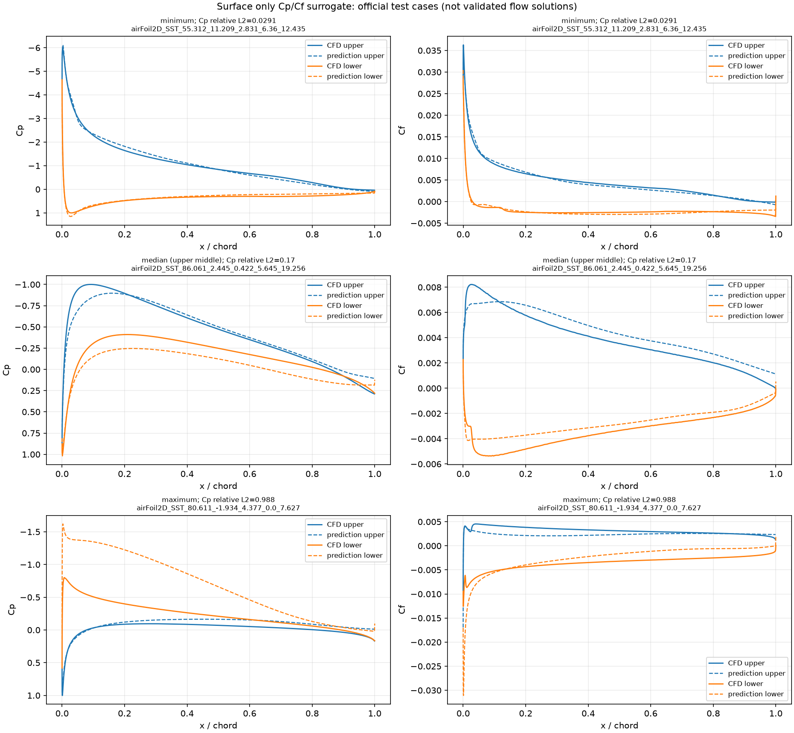

# 表面だけの Cp・Cf 予測（計画）

作成日: 2026-10-29。状態: **SURF-01 は実行済み（2026-10-30）。SURF-02〜12 は未実行**。コードは `surfcpcf/`（[PR #1](https://github.com/pandorobo11/transolver/pull/1)、main の commit `1c810f1`）。

## 目的

Mac mini（Apple M5 Pro、メモリ24GB、PyTorch MPS）で Transolver の扱いに慣れるため、AirfRANS の翼表面の点だけを使い、表面の圧力係数 Cp と表面摩擦係数 Cf を予測する。予測した Cp・Cf を翼面に沿って積分して Cl・Cd を求め、CFD の値と比べる。

体積場（約18万点/ケース）を使わないので、メモリと時間の負担が小さい。データの扱い、MPS での動作、学習と評価の流れを一通り作ることを優先する。

あわせて次の2つを調べる。

- 比較用の簡単なモデルと比べ、Transolver の点どうしの情報のやり取り（Physics-Attention）が精度に効いているか。
- Physics-Attention が翼面の点をどのようなまとまり（スライス）に分けているか。

関連する計画: 環境の検証は [20261029-standard-benchmark-repro](../20261029-standard-benchmark-repro/README.md)、体積場も学習させた場合との比較は [20261029-volume-vs-surface](../20261029-volume-vs-surface/README.md)。

## 位置づけ

- **独自の設定であり、論文の数値とは比較できない。** Transolver 論文の AirfRANS の結果は体積場と表面場を同時に学習した場合の指標（体積場・表面場の誤差、Cl・Cd の誤差、順位相関）で、本計画とは入力も目標も異なる。結果には「表面のみ、Cp・Cf」と明記する。
- データの分割は AirfRANS 公式の分割（`scarce`、`full`、`reynolds`、`aoa`）をそのまま使う。
- 予測は CFD の代わりになる検証済みの解ではない。学習範囲外（`reynolds`・`aoa` の外挿、学習にない形状）の結果は外挿として区別して示す。

## 取得するもの

| 対象 | 取得元 | 版 | ライセンス |
|---|---|---|---|
| Transolver 公式リポジトリ | `https://github.com/thuml/Transolver`（`Airfoil-Design-AirfRANS/` を使う） | commit `75e0f6764380`（2026-02-26 時点の HEAD） | MIT |
| `airfrans` ライブラリ | PyPI `airfrans`（ソースは `https://github.com/Extrality/airfrans_lib`） | 0.1.5.1 | GitHub の判定は MIT、README は ODbL-1.0 と記載 |
| AirfRANS データセット | `https://data.isir.upmc.fr/extrality/NeurIPS_2022/Dataset.zip`（`airfrans.dataset.download(root, OpenFOAM=False)` が使う URL） | 取得時に記録 | 取得時に確認して記録する（ODbL-1.0 の見込み） |

データセットの zip は 10,029,067,577 バイト（約10.0GB。2026-10-29 にダウンロード元の応答ヘッダで確認）。展開後はさらに大きくなる。

置き場所: リポジトリは `external/Transolver/`、データセットは `data/airfrans/`。どちらも Git 管理外。

## 正解値の作り方

AirfRANS の各ケースのファイルにある場は U、p、nut と法線で、壁面せん断応力と Cf は入っていない。`airfrans` の `Simulation.wallshearstress(reference=True)` が、CFD の速度場の勾配から表面の節点の τw = −2ν·S·n を計算する（`src/airfrans/simulation.py`）。公式の Cl・Cd の計算（`force_coefficient`）も、この τw と表面の p を積分している。

前処理でケースごとに次を1回だけ計算し、`data/airfrans_surface/` に保存する。

| 量 | 定義 |
|---|---|
| 表面の点 | `Simulation.surface`（U の x 成分が0の節点） |
| Cp | p / (½U∞²)。p は密度で割った圧力（m²/s²） |
| Cf | (τw · t) / (½U∞²)。t は法線 n を +90° 回転した単位接線 (−n_y, n_x)。符号付き。10月30日の確認で、vtp の法線は98%の点で翼の内向きだった。このため t は上面では下流、下面では上流を向き、付着流の Cf は上面で正、下面で負になる。剥離は、上面では Cf が負になる区間、下面では正になる区間として現れる |
| 力の積分に使う量 | 翼面の要素の長さと法線（`Simulation.airfoil` から） |

ν は `airfrans` の既定（T = 298.15 K）に合わせる。

## 共通の条件

| 項目 | 設定 |
|---|---|
| データ | AirfRANS、公式分割。表面の点を全点使う（間引かない） |
| 入力（6成分/点） | 位置 (x, y)、一様流の速度 (2成分)、法線 (2成分)。表面では壁からの距離が常に0なので除く |
| 目標（2成分/点） | Cp、Cf |
| 正規化 | 入力・目標とも学習データの平均と標準偏差で成分ごとに正規化する（Cf は Cp より桁が小さいため） |
| 損失 | 正規化した Cp と Cf の MSE の平均 |
| Transolver | 公式 `models/Transolver.py`。公式 `main.py` と同じく入力の全成分を space_dim に渡す（space_dim = 6、fun_dim = 0、out_dim = 2）。頭数8、mlp_ratio 2 は公式どおり。`unified_pos` は表面の点で意味を持つか確認してから決める |
| 点ごとの MLP | 入力・目標・正規化・損失は Transolver と同じ。各点を独立に予測し、点どうしの情報のやり取りがない。パラメータ数を Transolver と同程度にそろえる |
| パラメータ回帰 | ケースごとに1回の予測。入力は一様流の速度の大きさ、迎角、NACA のパラメータ（ケース名から読む。4桁系と5桁系で個数が違うので、揃え方は前処理で決める）。目標は CFD の Cl・Cd（`force_coefficient(reference=True)`）。全結合の小さな MLP |
| 学習 | バッチサイズ1（1ケース）、Adam、学習率 1e-3、OneCycleLR（公式 `train.py` と同じ） |
| 装置 | `mps`（使えなければ `cpu`）。`.cuda()` の直書きは置き換える。`PYTORCH_ENABLE_MPS_FALLBACK=1` を使ったかを記録する |
| 精度 | fp32 |

## 実行する学習（計画）

実行した学習は「実行した学習」の節に、計画と同じ実行IDで載せる。

| 実行ID | モデル | タスク | 学習ケース数 | 層数 | 隠れ次元 | スライス数 | エポック数 | 目的 |
|---|---|---|---|---|---|---|---|---|
| SURF-01 | Transolver | `scarce` | 200 | 5 | 128 | 32 | 200 | 動作確認。時間とメモリを測る |
| SURF-02 | Transolver | `full` | 800 | 5 | 128 | 32 | 200 | データ量の効果 |
| SURF-03 | Transolver | `reynolds` | 公式分割 | 5 | 128 | 32 | 200 | レイノルズ数の外挿 |
| SURF-04 | Transolver | `aoa` | 公式分割 | 5 | 128 | 32 | 200 | 迎角の外挿 |
| SURF-05 | 点ごとの MLP | `scarce` | 200 | 未定 | 未定 | — | 200 | SURF-01 との比較 |
| SURF-06 | 点ごとの MLP | `full` | 800 | 未定 | 未定 | — | 200 | SURF-02 との比較 |
| SURF-07 | 点ごとの MLP | `reynolds` | 公式分割 | 未定 | 未定 | — | 200 | SURF-03 との比較 |
| SURF-08 | 点ごとの MLP | `aoa` | 公式分割 | 未定 | 未定 | — | 200 | SURF-04 との比較 |
| SURF-09 | パラメータ回帰 | `scarce` | 200 | 未定 | 未定 | — | 未定 | SURF-01 の Cl・Cd との比較 |
| SURF-10 | パラメータ回帰 | `full` | 800 | 未定 | 未定 | — | 未定 | SURF-02 の Cl・Cd との比較 |
| SURF-11 | パラメータ回帰 | `reynolds` | 公式分割 | 未定 | 未定 | — | 未定 | SURF-03 の Cl・Cd との比較 |
| SURF-12 | パラメータ回帰 | `aoa` | 公式分割 | 未定 | 未定 | — | 未定 | SURF-04 の Cl・Cd との比較 |

Transolver の大きさとエポック数は公式の AirfRANS 設定（層数8、隠れ次元256、398エポック）より小さい。SURF-01 の結果を見て見直す。比較用モデルの「未定」は、SURF-01 の設定が決まってからパラメータ数をそろえて決める。テストは `scarce` と `full` が同じ200ケースを使う。

## 実行した学習

| 実行ID | 状態 | モデル | タスク | 学習ケース数 | 層数 | 隠れ次元 | スライス数 | エポック数 | 開始 |
|---|---|---|---|---|---|---|---|---|---|
| SURF-01 | 学習と評価が完了 | Transolver | `scarce` | 180（200 から公式どおり1割を検証に回す） | 5 | 128 | 32 | 200 | 2026-10-30 20:04 |

共通の条件は上の表のとおり。`unified_pos` は公式と同じ1にした（正規化前の座標から格子までの距離を特徴に加える）。乱数の種は0。テストは `full_test` の200ケース、表面の全点。

### 学習前の確認の結果（10月30日、`scarce_train` と `full_test` の400ケース）

| 確認 | 結果 |
|---|---|
| 1. 表面の点数、前処理の時間 | 1ケース 858〜1165点（平均1008）。前処理は1ケース平均0.37秒、400ケースで149秒 |
| 2. 自作の積分と `force_coefficient(reference=True)` | 6成分とも最大相対差 2e-14 以下で一致。要素の法線は vtp の要素の値ではなく、点の法線を要素に移した値（`airfoil.ptc()`）を使う必要があった（そのままだと Cd の圧力成分で 2.7e-3 ずれる） |
| 3. τw の法線成分 | 接線成分に対する大きさ（L2 ノルムの比）は中央値 0.0063、最大 0.027。法線成分を捨てると Cd が最大 2.6e-4、Cl が最大 4.1e-5（相対）ずれる |
| 4. 法線の向き、Cf の符号 | 法線は98%の点で翼の内向き。上面（前縁から5%を除く）の Cf は96%の点で正 |
| 5. MPS での動作 | `PYTORCH_ENABLE_MPS_FALLBACK` なしで順・逆伝播が通った |

### SURF-01 の結果

**表面のみ、Cp・Cf の独自の設定。論文の数値とは比較できない。** 縮小したモデル（公式は隠れ次元256、8層、398エポック）。テスト200ケースは、翼型のパラメータの組がすべて学習データにない。レイノルズ数が学習範囲外のケースが3、迎角が学習範囲外のケースが2ある（外挿）。値は [SURF-01-metrics.json](SURF-01-metrics.json)。

| 指標 | 平均 | 中央値 |
|---|---|---|
| Cp の相対L2誤差 | 0.209 | 0.170 |
| Cf の相対L2誤差 | 0.175 | 0.139 |
| Cl の相対誤差 | 0.486 | 0.145 |
| Cd の相対誤差 | 1.13 | 0.888 |
| Cd の圧力成分の相対誤差 | 3.55 | 2.38 |
| Cd の摩擦成分の相対誤差 | 0.049 | 0.035 |

順位相関（Spearman）: Cl 0.981、Cd −0.044。

同じテスト200ケースでの VOL-01（体積場も学習した公式コード、同じ大きさのモデルと200エポック）との比較:

| 指標（中央値） | SURF-01 | VOL-01 |
|---|---|---|
| Cl の相対誤差 | 0.145 | 0.093 |
| Cl の順位相関 | 0.981 | 0.980 |
| Cd の相対誤差 | 0.888 | 23.1 |
| Cd の摩擦成分の相対誤差 | 0.035 | 約35（予測が正解の約36倍） |
| Cd の圧力成分の相対誤差 | 2.38 | 2.62 |
| Cd の順位相関 | −0.044 | −0.027 |

VOL-01 の値は [VOL-01 の結果](../20261029-volume-vs-surface/README.md#vol-01-の結果)から。VOL-01 は全点を乱数で間引いて推論しており、評価の手順が同じではない。どちらも学習1回。

わかったこと:

- Cf を直接予測すると、Cd の摩擦成分は中央値 3.5% の誤差で求まる。体積場の速度の勾配から求めた VOL-01（約36倍）の問題は、表面だけのモデルでは起きない。
- Cd 全体はまだ予測できていない。誤差の大部分は圧力成分から来ており、その誤差は VOL-01 と同程度。Cd の圧力成分は大きな圧力の力の差として残る小さな量なので、Cp の誤差（相対L2で約17%）がそのまま大きく出る。
- Cl は、SURF-01 のほうが VOL-01 より誤差がやや大きい（中央値 0.145 と 0.093）。順位相関は同程度。
- 学習の損失は最後に 0.009 まで下がった一方、検証の MSE は Cp 0.024、Cf 0.033 で、過学習の傾向がある。学習データは180ケース。

学習の途中の検証の MSE（正規化後、検証20ケース）:

| エポック | 学習の損失 | 検証 Cp | 検証 Cf |
|---|---|---|---|
| 1 | 0.941 | 0.621 | 0.592 |
| 50 | 0.479 | 0.378 | 0.256 |
| 100 | 0.129 | 0.0740 | 0.0697 |
| 150 | 0.0329 | 0.0537 | 0.0474 |
| 200 | 0.00914 | 0.0244 | 0.0330 |

Cp の相対L2誤差が最小・中央・最大のテストケースの Cp・Cf 分布（破線が予測）:



誤差が最大のケース（迎角 −1.9°、後縁が反った5桁系）では、下面の負圧を大きく過大に予測している。

### 時間とメモリ（SURF-01）

| 項目 | 値 |
|---|---|
| 1エポックの時間（学習と、10エポックごとの検証） | 平均3.7秒 |
| 学習全体（データの読み込みを含む） | 739秒（約12分） |
| 評価（テスト200ケースの推論と積分） | 1.6秒 |
| MPS が確保したメモリ | 0.17 GiB |
| プロセスのピークメモリ | 1.6 GB |
| `PYTORCH_ENABLE_MPS_FALLBACK` | 未設定 |
| パラメータ数 | 967,754 |

参考: 2エポックの試運転では、1エポックが MPS で3.7秒、CPU で2.3秒だった。1ケース約1000点と小さいので、CPU のほうが速い。

## 評価

| 指標 | 内容 |
|---|---|
| 表面場の誤差 | テストケースごとの Cp・Cf の相対L2誤差の平均 |
| 力係数 | Cl、Cd（圧力成分と粘性成分に分けて）の相対誤差の平均 |
| 順位相関 | テストケース全体での Cl・Cd の Spearman 順位相関（AirfRANS の評価に合わせる） |
| 分布の比較 | 代表ケースの Cp・Cf 分布を CFD と重ねた図 |
| スライスの割り当て | SURF-01・SURF-02 の代表ケースで、層ごとに各点が最も重みを持つスライスを翼面上に色分けした図。Cp・Cf 分布と並べ、よどみ点、負圧のピーク、後縁、剥離域などと対応するかを見る |

比較用モデルとの比べ方:

- 点ごとの MLP（SURF-05〜08）とは、表面場の誤差と力係数の誤差を同じテストケースで比べる。
- パラメータ回帰（SURF-09〜12）は Cl・Cd しか出さないので、力係数の誤差と順位相関だけを比べる。

時間とメモリ（1エポックの時間、ピークメモリ、前処理の時間）は精度とは別の表に記録する。

## 学習の前に確かめること

1. 表面の点数（ケースごとの最小・平均・最大）と、前処理の時間（1ケースあたり）。
2. 自作の積分で、CFD の Cp・Cf から求めた Cl・Cd が `force_coefficient(reference=True)` の値と一致すること。一致しなければ評価の基準にできない。
3. τw の法線方向の成分が接線成分に比べて十分小さいこと（Cf を接線成分だけにして失う量の確認）。
4. 法線の向き（翼の外向きか内向きか）と、それに応じた Cf の符号。
5. 公式モデルが MPS でフォールバックなしに動くこと。

## 限界

- 正解の Cf は OpenFOAM が出力した値ではない。`airfrans` が体積メッシュの速度場から数値微分で求めた値で、壁近くのメッシュの細かさに精度が左右される。公式の Cd も同じ方法で計算するので、比較の基準としては揃っている。
- 表面の点は1ケースあたり数百〜千点程度の見込みで、Physics-Attention（点をスライスにまとめる仕組み）の利点は出にくい。

## 再現手順

環境は [VOL-01 の再現手順](../20261029-volume-vs-surface/README.md#再現手順)と同じ（torch 2.15.0 など）に、`airfrans` 0.1.5.1 と `pytest` を加えた。データは同じ AirfRANS の `Dataset.zip`（SHA-256 `6b301d75…96db`）。コードは `surfcpcf/`（main の commit `1c810f1`）。リポジトリのルートで実行した。

```sh
VIRTUAL_ENV=local/venv-bench uv pip install airfrans==0.1.5.1 pytest
PY=local/venv-bench/bin/python
$PY -m pytest -q tests
$PY -m surfcpcf.preprocess --dataset data/airfrans/Dataset --out data/airfrans_surface --splits scarce_train full_test
$PY -m surfcpcf.checks --surface data/airfrans_surface --dataset data/airfrans/Dataset \
  --transolver-dir external/Transolver/Airfoil-Design-AirfRANS --out results/surface/checks.json
caffeinate -i $PY -m surfcpcf.train --task scarce --surface data/airfrans_surface \
  --transolver-dir external/Transolver/Airfoil-Design-AirfRANS --out results/surface/SURF-01 \
  --n-hidden 128 --n-layers 5 --slice-num 32 --epochs 200 --lr 1e-3 --seed 0 --val-every 10
$PY -m surfcpcf.evaluate --run results/surface/SURF-01 --surface data/airfrans_surface \
  --transolver-dir external/Transolver/Airfoil-Design-AirfRANS
```

実装は、Claude が書いた計画をもとに Codex（gpt-6.1-sol、推論レベル high）が書き、Claude が差分のレビューと検証の再実行をした。
