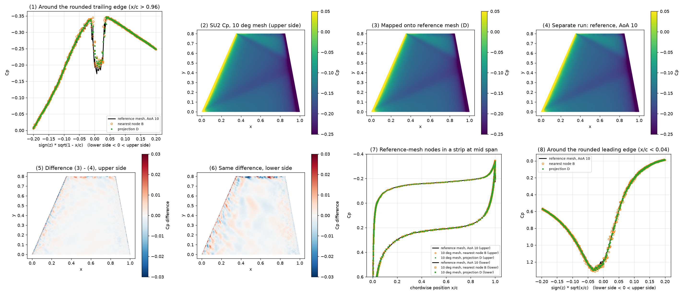

# 舵角の違う表面格子の Cp を共通格子へ補間する検証（全遊動翼単体、SU2 Euler）

作成日: 2026-11-14。状態: **4 ケースとも実行済み**。

舵角ごとに別々に生成した表面格子（節点数が違う）の圧力係数 Cp を、1 つの基準格子へ補間する手順を、SU2 の Euler 解析で確かめた記録。サロゲートモデルの学習データを共通格子にそろえる前処理として使う。

## 結論

- 舵角を戻してから、最近接点を三角形面上に投影し、重心座標で補間する方法で、補間前後の法線力と舵軸まわりのモーメントの変化は 0.1% 未満だった。
- 舵角を戻さずに補間すると、法線力が 41〜68% ずれて使えない。
- 補間した Cp と、基準格子で別に解いた Cp の差は、縁から離れた翼面で RMS 0.004、丸めた縁のまわりで RMS 0.009 だった。この差には、格子の違いによる CFD 解の差が含まれる。
- 丸い後縁の真後ろの Cp は、Euler 解析では格子と数値粘性に依存する。学習データに使うときは、この部分の値を信用しない。

## 補間の手順

1. 舵角 δ の格子の表面節点を、舵軸まわりに −δ 回して翼固定座標に戻す。翼の形状は基準格子（舵角 0）と一致する。
2. 基準格子の各節点から、元格子の三角形面上の最近接点を求める。候補は三角形の重心が近い 24 個に絞る。法線が基準節点の法線と逆向きの三角形（裏面）は候補から外す。
3. 最近接点の重心座標を重みにして、三角形の 3 頂点の Cp を平均する。

補間の前後で、Cp を面積分した力とモーメントを比べ、補間で値が崩れていないことを確かめる。

## 検証の考え方

翼単体では、「舵角 δ・迎角 0」と「舵角 0・迎角 δ」は同じ流れになる。そこで次の 2 つを比べた。

- 舵角 δ の格子を迎角 0 で解き、その Cp を基準格子へ補間したもの。
- 基準格子を迎角 δ で解いたもの。

2 つの差には、補間の誤差と、格子の違いによる CFD 解の差の両方が入る。補間の誤差だけを切り分けることはできない。補間そのものの質は、補間前後の力の変化で見る。

## 共通条件

| 項目 | 値 |
|---|---|
| 形状 | 対称面（y = 0）に取り付けた台形翼。付け根翼弦 1、翼端翼弦 0.5、翼幅 0.8、翼端の前縁位置 x = 0.35 |
| 翼型 | z/c = ±(a0 √(ξ(1−ξ)) + b ξ(1−ξ))、a0 = 0.1、b = −0.08。最大翼厚比 6%、前縁半径と後縁半径は局所翼弦長の 0.5% |
| 舵軸 | y 軸に平行で (x, z) = (0.45, 0) を通る。正の舵角で前縁が +z 側に上がる |
| 解析 | SU2 8.5.0、Euler、Mach 2、Roe＋MUSCL、Venkatakrishnan の制限関数（係数 0.05、400 反復目で固定）、陰解法、CFL 5〜50 の自動調整 |
| 収束判定 | 密度残差の常用対数が −8 以下 |
| 基準量 | 基準面積 0.6（翼の平面面積）、基準長 1、モーメントの基準点は舵軸上の (0.45, 0, 0) |
| 計算領域 | x −2〜5、y 0〜3、z −3〜3 の直方体。y = 0 は対称面、ほかは遠方境界 |
| 格子 | Gmsh 4.15.2 の四面体格子。遠方の格子幅 0.5 |
| 並列数 | 12 |

制限関数を固定しないと、密度残差が 2 桁台で停滞した。固定の前後で空力係数は 6 桁一致した。

## 格子

舵角ごとに、翼面の格子幅と 2 次元の分割アルゴリズムを変えて生成した。同じ設定で舵角だけを変えると、Gmsh はほぼ同じ翼面格子を作るので、補間の検証にならないためである。

| 格子 | 舵角 [deg] | 翼面の格子幅 | 縁まわりの格子幅 | 2 次元アルゴリズム | 翼面の節点数 | 翼面の三角形数 | 全節点数 | 四面体数 |
|---|---|---|---|---|---|---|---|---|
| mesh-round2-d00（基準） | 0 | 0.012 | 0.0010 | 6（Frontal-Delaunay） | 138,608 | 276,892 | 516,903 | 2,766,198 |
| mesh-round2-d05 | 5 | 0.013 | 0.0011 | 6（Frontal-Delaunay） | 116,575 | 232,847 | 430,707 | 2,298,714 |
| mesh-round2-d10 | 10 | 0.011 | 0.0009 | 5（Delaunay） | 186,910 | 373,468 | 654,272 | 3,464,633 |

翼面の節点の約 7 割は、丸めた前縁・後縁から翼弦の 3% 以内にある。

## 実行したケース

設定は [case.cfg](case.cfg) で、ケースごとに違うのは格子と迎角（`AOA`）だけである。

| ケース | 格子 | 迎角 [deg] | 反復数 | 密度残差（log10） | CL | CD | CMy（舵軸） | 計算時間 [s] |
|---|---|---|---|---|---|---|---|---|
| r4-round2-ref-a05 | mesh-round2-d00 | 5 | 418 | −8.02 | 0.17809 | 0.05036 | −0.00868 | 133 |
| r4-round2-d05-a00 | mesh-round2-d05 | 0 | 414 | −8.08 | 0.17811 | 0.05026 | −0.00872 | 113 |
| r4-round2-ref-a10 | mesh-round2-d00 | 10 | 427 | −8.03 | 0.35607 | 0.09807 | −0.01801 | 137 |
| r4-round2-d10-a00 | mesh-round2-d10 | 0 | 416 | −8.05 | 0.35601 | 0.09818 | −0.01799 | 182 |

4 ケースとも収束した。計算時間は Mac mini（12 並列）での実測で、精度の結論とは別の観測である。

## 結果

値は [summary.json](summary.json) にある。

### 補間前後の力の変化

元格子の解（SU2 の出力）を翼固定軸で積分した値を基準にした、基準格子へ補間した後の変化。CN は法線力係数、CA は軸力係数、CMy は舵軸まわりのモーメント係数。

| 元のケース | 手法 | CN の変化 | CA の変化 | CMy の変化 |
|---|---|---|---|---|
| r4-round2-d05-a00 | A: 回転を戻さず最近傍節点 | −41.1% | −3.9% | −73.0% |
| r4-round2-d05-a00 | B: 回転を戻して最近傍節点 | −0.01% | +0.03% | −0.34% |
| r4-round2-d05-a00 | C: 回転を戻して投影＋重心座標 | −0.01% | −0.00% | −0.07% |
| r4-round2-d05-a00 | D: C に法線チェックを追加 | −0.01% | −0.00% | −0.07% |
| r4-round2-d10-a00 | A: 回転を戻さず最近傍節点 | −67.6% | +18.7% | −94.7% |
| r4-round2-d10-a00 | B: 回転を戻して最近傍節点 | −0.00% | −0.02% | −0.02% |
| r4-round2-d10-a00 | C: 回転を戻して投影＋重心座標 | −0.02% | −0.02% | −0.07% |
| r4-round2-d10-a00 | D: C に法線チェックを追加 | −0.02% | −0.02% | −0.07% |

- 回転を戻した後の投影距離は、中央値 1×10⁻⁶、最大 7×10⁻⁵（翼弦長 1 に対して）で、形状は一致している。
- C と D は同じ値になった。この格子では、法線チェックで結果が変わる節点がなかった。
- 力の変化だけを見ると、B と C・D の差は小さい。縁まわりの格子幅が 0.001 と細かいためである。

### 基準格子で別に解いた Cp との差

補間した Cp と、基準格子で迎角を付けて解いた Cp の、基準格子の節点ごとの差。「縁のまわり」は前縁・後縁から翼弦の 3% 以内の節点（99,146 個）、「それ以外」は残りの節点。

| 元のケース → 比較相手 | 手法 | 全体の RMS | 縁のまわりの RMS | 縁のまわりの最大 | それ以外の RMS | それ以外の最大 |
|---|---|---|---|---|---|---|
| r4-round2-d05-a00 → r4-round2-ref-a05 | B | 0.0135 | 0.0156 | 0.183 | 0.0055 | 0.344 |
| r4-round2-d05-a00 → r4-round2-ref-a05 | D | 0.0079 | 0.0089 | 0.107 | 0.0046 | 0.222 |
| r4-round2-d10-a00 → r4-round2-ref-a10 | B | 0.0125 | 0.0144 | 0.153 | 0.0050 | 0.182 |
| r4-round2-d10-a00 → r4-round2-ref-a10 | D | 0.0083 | 0.0094 | 0.129 | 0.0042 | 0.102 |

- 投影＋重心座標（D）は、最近傍節点（B）より全体の RMS が 3〜4 割小さい。
- 比較する 2 つの解（補間前）の法線力の差は約 0.01% で、補間による変化と同じ程度である。

### 図（舵角 10° の組）



- (1) 丸めた後縁のまわりの Cp。横軸は後縁を回り込む座標で、負が下面、正が上面。
- (2) SU2 の Cp（舵角 10° の格子、翼固定座標、上面）。
- (3) 基準格子へ補間した Cp（手法 D）。
- (4) 基準格子を迎角 10° で解いた Cp。
- (5)(6) (3) と (4) の差。上面と下面。
- (7) 翼幅中央の帯にある基準格子の節点での比較。
- (8) 丸めた前縁のまわりの Cp。横軸は前縁を回り込む座標。

## 注意点と未確認のこと

- **後縁の真後ろの圧力**：図の (1) の中央で Cp が波打っている。Euler 解析では、丸い後縁を回り込む流れの剥離位置が物理的に決まらず、格子と数値粘性に依存する。この部分は実機の底面圧を表していない。
- **翼単体である**：胴体は含んでいない。舵角によって胴体側の濡れ面（翼の付け根の隙間や、翼に隠れる領域）が変わる場合の扱いは確かめていない。
- **Euler 解析である**：粘性の効果は入っていない。Mach 2、舵角 5° と 10° の 2 点だけで確かめた。
- **格子収束は確かめていない**：比較した 2 つの解の差に、格子の粗さがどれだけ効いているかは分けていない。
- **後縁が尖った翼**：同じ手順を、前縁・後縁とも尖った翼と、前縁だけ丸めた翼でも試した（記録は残していない）。最近傍節点では後縁の近くで反対側の面の節点を拾い、舵軸まわりのモーメントが前縁だけ丸めた翼で最大約 2 割ずれた。投影＋重心座標ではこのずれは 1% 以下だった。

## スクリプトの使い方

| ファイル | 役割 |
|---|---|
| [gen_mesh.py](gen_mesh.py) | 舵角を指定して、翼単体の四面体格子（SU2 形式）を生成する |
| [case.cfg](case.cfg) | SU2 の設定。`AOA` をケースに合わせて書き換える |
| [apply_su2.py](apply_su2.py) | SU2 の表面出力を読み、補間・力の比較・図と集計の出力を行う |

### 必要なもの

- Python と `numpy`、`scipy`、`matplotlib`。格子生成には `gmsh`（`pip install gmsh`）も使う。
- SU2 8.5.0 と MPI。

### 1. 格子を生成する

```sh
python gen_mesh.py 0  cases/mesh-round2-d00
python gen_mesh.py 5  cases/mesh-round2-d05 --h-fin 0.013 --h-le 0.0011 --algo2d 6
python gen_mesh.py 10 cases/mesh-round2-d10 --h-fin 0.011 --h-le 0.0009 --algo2d 5
```

- 第 1 引数が舵角 [deg]、第 2 引数が出力先。`mesh.su2` と、節点数などを記録した `mesh.json` ができる。
- `--h-fin` は翼面の格子幅、`--h-le` は丸めた縁のまわりの格子幅、`--algo2d` は Gmsh の 2 次元アルゴリズムの番号。
- 境界の名前は `fin`（翼面）、`sym`（対称面）、`far`（遠方）。
- 翼の寸法、翼厚、縁の半径、舵軸の位置は、スクリプト冒頭の定数で変える。
- 格子生成は並列で行うため、同じ引数でも節点数が少し変わる（再生成した舵角 5° の格子は、翼面の節点が 116,529 個で、上の表より 46 個少なかった）。

### 2. SU2 で解く

ケースごとにフォルダを作り、`mesh.su2` と `case.cfg` を置いて実行する。フォルダ名は下の 4 つにする（`apply_su2.py` がこの名前で読む）。

| フォルダ | 格子 | `AOA` |
|---|---|---|
| r4-round2-ref-a05 | mesh-round2-d00 | 5.0 |
| r4-round2-d05-a00 | mesh-round2-d05 | 0.0 |
| r4-round2-ref-a10 | mesh-round2-d00 | 10.0 |
| r4-round2-d10-a00 | mesh-round2-d10 | 0.0 |

```sh
mpirun -np 12 SU2_CFD case.cfg
```

`apply_su2.py` は、各フォルダの次の 3 つを読む。

- `surface_flow.csv`：翼面の節点の `PointID`、座標、`Pressure_Coefficient`。Cp を出力するため、設定で `WRT_RESTART_COMPACT= NO` にしている。
- `mesh.su2`：境界 `fin` の三角形の接続。
- `run.json`：ケースの状態と最終の空力係数。次の形で作る（値は `history.csv` の最終行から取る）。

```json
{"state": "converged", "final": {"rms_rho": -8.02, "CFz": 0.1811, "CMy": -0.0087}}
```

`CFz` と `CMy` は、表面 Cp を積分した値との照合に使う。今回の計算では、ケースを順に実行して `run.json` を書き出す別のスクリプトを使った（このリポジトリには含めていない）。

### 3. 補間して比較する

```sh
python docs/reports/20261114-fin-remap-su2/apply_su2.py --results <4 ケースのフォルダを置いた場所>
```

- 標準出力に、ケースの組ごとの力の比較と Cp の差の表が出る。
- スクリプトと同じフォルダに `fin_remap_su2.png` と `summary.json` を書き出す。
- 最初に、SU2 が出力した `CFz`・`CMy` と、表面 Cp を自前で積分した値を並べて表示する。ここが一致しないときは、読み込みか三角形の向きに誤りがある。

### 別の形状に使うとき

`apply_su2.py` のうち、形状に依存するのは次の部分である。

- `rotate_about_hinge`：舵軸が y 軸に平行で x = `HINGE_X` を通ることを前提にしている。
- `load_case` の向きの決定：翼端面は +y 向き、それ以外は翼弦線上の内部点から離れる向きを外向きとしている。断面が凸であることが前提。
- `chord_coords`：台形翼の平面形から翼弦位置を求めている。集計の区分と図にだけ使う。

補間そのもの（`map_barycentric`、`closest_point_barycentric`）は形状に依存しない。任意の三角形格子と、問い合わせる点・法線を渡せば使える。
