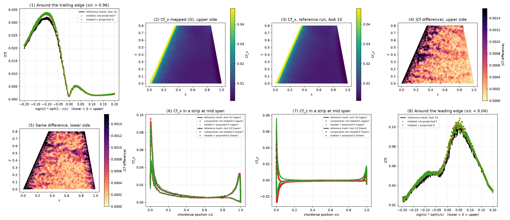

# 舵角の違う表面格子の摩擦係数 Cf を共通格子へ補間する検証（全遊動翼単体、SU2 層流）

作成日: 2026-11-17。状態: **4 ケースとも実行済み**。

> 11 月 19 日追記：翼面にプリズム層を付けた格子で確かめ直した（[記録](../20261119-fin-cf-remap-prism/README.md)）。補間の手順の結論は変わらないが、この記録の Cf の値はプリズム層の値の半分以下で、格子による約 3% の差も境界層を解像していないためだった。

舵角ごとに別々に生成した表面格子の摩擦係数 Cf を、1 つの基準格子へ補間して積分する手順を、SU2 の層流 Navier–Stokes 解析で確かめた記録。[Cp の補間の検証（2026-11-14）](../20261114-fin-remap-su2/README.md)の続きで、同じ翼と同じ格子を使う。

確かめるのは補間と積分の手順であり、Cf の値そのものの精度ではない。境界層格子は使わず、レイノルズ数を 5,000 まで下げて計算を小さくした。

## 結論

- Cf は 3 成分のベクトルとして扱う。座標と同じ回転で成分を翼固定座標に戻し、成分ごとに補間し、基準格子の法線方向の成分を除く（手法 G）。この方法で、補間前後の摩擦軸力の変化は 0.02% 以下だった。
- 成分を回さずに補間すると、摩擦の法線力の符号が変わる（舵角 10° で 0.00144 が −0.00219 になる）。
- 接平面への射影による損失は、丸めた縁のまわりの摩擦軸力で 0.07〜0.09% だった。
- 摩擦力は、三角形ごとに 3 頂点の Cf を平均し、面積を掛けて足す。SU2 の力の内訳と比べると、圧力分は小数第 5 位まで、摩擦分の x 成分は 0.2% 以下の差で一致した。
- 摩擦分の z 成分には、SU2 の内訳との差が 0.0003〜0.0004 残った。11 月 17 日の追加の確認で、この差は SU2 が摩擦力に含める粘性応力の法線成分だと分かった。x 成分の小さな差は、主に SU2 の節点面積の取り方による。この 2 つを入れると、SU2 の摩擦分を 4 ケースとも 1e-6 の差で再現できた（[摩擦分の差の内訳](#摩擦分の差の内訳11-月-17-日に追加)）。
- 力の積分は、Cp の積分に、接線成分だけの Cf を三角形ごとに積分した値を足すのが、連続の式とも、節点値の線形補間とも整合する。SU2 の法線分は物理的には 0 になるべき離散化誤差で、どちらの差も格子の違いによる約 3% より小さい。
- 補間した Cf と、基準格子で別に解いた Cf の差は、摩擦軸力で約 3% だった。補間前後の変化より 2 桁大きく、格子の違いによる CFD 解の差である。

## 補間と積分の手順

位置の対応は Cp の検証で採用した方法（舵角を戻し、最近接点を三角形面上に投影し、裏面の三角形を除く）と同じである。

1. SU2 の表面出力から、Cf を 3 成分のベクトルとして読む。物体が受ける向きの壁面せん断応力を、一様流の動圧で割ったものである。
2. 舵角 δ の格子の節点を舵軸まわりに −δ 回し、Cf の成分にも同じ回転をかける。
3. 基準格子の各節点について、最近接点の重心座標を重みにして、三角形の 3 頂点の Cf を成分ごとに平均する。
4. 基準格子の節点の法線方向の成分を除く（接平面へ射影）。

摩擦力は、三角形ごとに 3 頂点の Cf を平均し、面積を掛けて足す。法線は掛けない。全体の力は、Cp の積分と Cf の積分の和になる。

## 検証の考え方

Cp の検証と同じく、翼単体では「舵角 δ・迎角 0」と「舵角 0・迎角 δ」が同じ流れになることを使う。

- 補間そのものの質は、補間前後の摩擦力の変化で見る。
- 積分の正しさは、SU2 が出力する力の内訳（圧力分と摩擦分）との照合で見る。
- 補間した Cf と、基準格子を迎角 δ で解いた Cf の差には、補間の誤差と、格子の違いによる CFD 解の差の両方が入る。

Cf の扱いは 3 通りを比べた。

| 手法 | 内容 |
|---|---|
| E | 成分を回さずに補間する（座標だけ回転を戻す） |
| F | 成分を回して補間する |
| G | F の後に接平面へ射影する |

## 共通条件

| 項目 | 値 |
|---|---|
| 形状 | Cp の検証と同じ台形翼。付け根翼弦 1、翼端翼弦 0.5、翼幅 0.8、最大翼厚比 6%、前縁半径と後縁半径は局所翼弦長の 0.5% |
| 舵軸 | y 軸に平行で (x, z) = (0.45, 0) を通る |
| 解析 | SU2 8.5.0、層流の Navier–Stokes（乱流モデルなし）、Mach 2、Roe＋MUSCL、Venkatakrishnan の制限関数（係数 0.05、400 反復目で固定）、陰解法、CFL 5〜50 の自動調整 |
| レイノルズ数 | 5,000（付け根翼弦基準） |
| 粘性係数 | 0.16674 Pa·s で一定。一様流の圧力 101,325 Pa、温度 288.15 K と Mach 数から、上のレイノルズ数になる値を計算した |
| 熱伝導 | プラントル数 0.72 で一定 |
| 翼面 | 断熱壁（熱流束 0） |
| 収束判定 | 密度残差の常用対数が −8 以下 |
| 基準量 | 基準面積 0.6、基準長 1、モーメントの基準点は舵軸上の (0.45, 0, 0) |
| 格子 | Gmsh 4.15.2 の四面体格子。境界層格子なし。11 月 14 日の `finremap` の動作確認で生成したものをそのまま使った |
| 並列数 | 12（Open MPI 5.0.9） |

レイノルズ数は、平板の層流境界層の厚さの見積もり（後縁で翼弦の 1 割弱）が翼面の格子幅の数倍になるように選んだ。実際に境界層が何セルで解像されているかは確かめていない。

## 格子

| 格子 | 舵角 [deg] | 翼面の格子幅 | 縁まわりの格子幅 | 2 次元アルゴリズム | 翼面の節点数 | 翼面の三角形数 | 全節点数 | 四面体数 |
|---|---|---|---|---|---|---|---|---|
| ref（基準） | 0 | 0.012 | 0.0010 | 6 | 138,453 | 276,582 | 517,113 | 2,768,348 |
| d05 | 5 | 0.013 | 0.0011 | 6 | 116,493 | 232,683 | 430,946 | 2,300,968 |
| d10 | 10 | 0.011 | 0.0009 | 5 | 187,025 | 373,698 | 654,979 | 3,468,340 |

## 実行したケース

設定は [case.cfg](case.cfg)（ref-a10 のもの）で、ケースごとに違うのは格子と迎角（`AOA`）だけである。

| ケース | 格子 | 迎角 [deg] | 結果 | 反復数 | 密度残差（log10） | CL | CD | CMy（舵軸） |
|---|---|---|---|---|---|---|---|---|
| ref-a05 | ref | 5 | converged | 461 | −8.02 | 0.17445 | 0.07779 | −0.00130 |
| d05-a00 | d05 | 0 | converged | 458 | −8.01 | 0.17386 | 0.07729 | −0.00121 |
| ref-a10 | ref | 10 | converged | 450 | −8.03 | 0.34445 | 0.12362 | −0.00413 |
| d10-a00 | d10 | 0 | converged | 479 | −8.03 | 0.34278 | 0.12372 | −0.00447 |

SU2 が出力した力の内訳（格子の座標系）は次のとおり。

| ケース | CFx 圧力分 | CFx 摩擦分 | CFz 圧力分 | CFz 摩擦分 |
|---|---|---|---|---|
| ref-a05 | 0.04176 | 0.02053 | 0.17963 | 0.00093 |
| d05-a00 | 0.05740 | 0.01988 | 0.17467 | −0.00081 |
| ref-a10 | 0.04180 | 0.02012 | 0.35886 | 0.00182 |
| d10-a00 | 0.10295 | 0.02077 | 0.34454 | −0.00176 |

計算時間は、Mac mini（12 並列）での実測で、精度の結論とは別の観測である。

| ケース | 計算時間 [s] |
|---|---|
| ref-a05 | 166 |
| d05-a00 | 136 |
| ref-a10 | 154 |
| d10-a00 | 222 |

## 結果

値は [summary.json](summary.json) にある。

### 積分と SU2 の内訳の照合

元格子の解について、SU2 の力の内訳と、表面の Cp・Cf を積分した値を並べる。格子の座標系の成分である。

| 元のケース | 成分 | 圧力分（SU2） | 圧力分（積分） | 摩擦分（SU2） | 摩擦分（積分） |
|---|---|---|---|---|---|
| d05-a00 | CFx | 0.05740 | 0.05740 | 0.01988 | 0.01991 |
| d05-a00 | CFz | 0.17467 | 0.17467 | −0.00081 | −0.00107 |
| d05-a00 | CMy | −0.00125 | −0.00126 | 0.00004 | 0.00002 |
| d10-a00 | CFx | 0.10295 | 0.10295 | 0.02077 | 0.02075 |
| d10-a00 | CFz | 0.34454 | 0.34454 | −0.00176 | −0.00219 |
| d10-a00 | CMy | −0.00455 | −0.00456 | 0.00008 | 0.00004 |

- 圧力分の力は、小数第 5 位まで一致した。
- 摩擦分の CFx の差は、どちらのケースも 0.2% 以下だった（表の桁では 0.00003 と 0.00002）。
- 摩擦分の CFz には、0.00026 と 0.00043 の差が残った。全体の法線力（0.17〜0.34）に対しては 0.15% 以下である。

摩擦分が完全には一致しない理由として、SU2 のソース（`Friction_Forces`）から分かることが 2 つある。確認に使ったソースは手元で手を入れた複製で、解析に使った 8.5.0 そのものではない。2 つの寄与は、次の節で解から切り分けた。

- SU2 は力の積分に粘性応力の法線成分も含めるが、出力される Cf は接線成分だけである。
- SU2 は節点の面積として、まわりの三角形の面積ベクトルの和の大きさを使う。曲率のある面では、三角形の面積の和より小さくなる。

### 摩擦分の差の内訳（11 月 17 日に追加）

restart の解と体積格子から、壁面節点の速度勾配を SU2 と同じ方法（辺でつながる点を使い、重み 1/|d|² の最小二乗）で計算し直した。これで粘性応力 τ を作り、τ·n を接線成分と法線成分に分けて、SU2 と同じ節点ごとの求積で積分した。n は、まわりの三角形の面積ベクトルの 1/3 の和を正規化したものである。スクリプトは [friction_check.py](friction_check.py)、値は [friction_check.json](friction_check.json) にある。

計算し直した接線応力と、SU2 が出力した Cf の差は、4 ケースとも RMS で 0.2% だった。勾配の計算は SU2 と同じものになっている。

格子の座標系の摩擦分の係数を並べる。「接線分」と「法線分」は SU2 と同じ節点の求積の値、「三角形積分」は出力の Cf を三角形ごとに積分した値（`finremap` の積分）である。

| ケース | 成分 | SU2 の内訳 | 接線分 ＋ 法線分 | 接線分 | 法線分 | 三角形積分 |
|---|---|---|---|---|---|---|
| ref-a05 | CFx | 0.020529 | 0.020529 | 0.020543 | −0.000014 | 0.020580 |
| ref-a05 | CFz | 0.000932 | 0.000932 | 0.000688 | 0.000244 | 0.000693 |
| ref-a05 | CMy | 0.000044 | 0.000044 | 0.000021 | 0.000023 | 0.000021 |
| d05-a00 | CFx | 0.019884 | 0.019885 | 0.019874 | 0.000011 | 0.019911 |
| d05-a00 | CFz | −0.000806 | −0.000806 | −0.001069 | 0.000264 | −0.001068 |
| d05-a00 | CMy | 0.000037 | 0.000037 | 0.000016 | 0.000022 | 0.000015 |
| ref-a10 | CFx | 0.020122 | 0.020123 | 0.020141 | −0.000018 | 0.020176 |
| ref-a10 | CFz | 0.001820 | 0.001821 | 0.001367 | 0.000454 | 0.001376 |
| ref-a10 | CMy | 0.000086 | 0.000086 | 0.000037 | 0.000048 | 0.000037 |
| d10-a00 | CFx | 0.020772 | 0.020772 | 0.020715 | 0.000057 | 0.020749 |
| d10-a00 | CFz | −0.001756 | −0.001756 | −0.002196 | 0.000439 | −0.002193 |
| d10-a00 | CMy | 0.000078 | 0.000078 | 0.000039 | 0.000039 | 0.000039 |

- 接線分と法線分の和は、SU2 の内訳と 1e-6 以内で一致した。差の原因はこの 2 つで尽きている。
- **z 成分と CMy の差は法線分による**。翼面の法線はほぼ z 方向なので、法線分の寄与は z 成分に出る。法線応力 τ_nn の大きさは、接線応力に対して RMS で 9% 前後だった。上の表の CMy の差（0.00004 と 0.00002 など）も同じ原因である。
- **x 成分の差は、主に節点面積の取り方による**。接線分だけで比べると、SU2 の求積は三角形積分より 0.1〜0.2% 小さい。節点面積 |Σ a_t/3| と Σ |a_t|/3 の比は、翼端や付け根の角の節点で最小 0.71 だった。面積を Σ |a_t|/3 にした節点の求積は、三角形積分と 1e-6 程度で一致する（JSON の `tangent_nodal_area_sum`）。

### どう積分するのが正しいか

この記録の条件（定常、静止した壁、すべりも吹き出しもない）では、壁の力は「圧力 ＋ 接線方向のせん断」で尽きる。積分は、Cp の積分に、接線成分だけの Cf を三角形ごとに積分した値を足すのが正しい。`finremap` の積分はこれに当たる。

- **連続の式では τ_nn = 0 になる**。壁上では u = 0 なので、u の接線方向の微分と曲率の項は消え、div u = ∂u_n/∂n になる。定常の連続の式は壁上で ρ div u = 0 になるので、∂u_n/∂n = 0 である。よって τ_nn = 2μ ∂u_n/∂n − (2/3)μ div u = 0 で、体積粘性を入れても同じである。SU2 の内訳の法線分は、境界層格子のない壁面格子で勾配を離散化した誤差であり、格子を細かくすれば 0 に近づくはずである（確かめていない）。非定常の圧縮性流れ、動く壁、吹き出しのある壁では τ_nn が残りうる。
- **三角形ごとの積分は、節点値の線形補間と整合する**。線形に補間した場の厳密な積分は、三角形ごとの「3 頂点の平均 × 面積」の和である。圧力では、Σ_t a_t ×（3 頂点の平均）を節点ごとに並べ替えると SU2 の Σ_i p_i A_i と同じ式になる。圧力分が小数第 5 位まで一致したのはこのためである。摩擦で整合するのは Σ_i τ_i Σ_t |a_t|/3 だが、SU2 は |Σ_t a_t/3| を使うので、面が曲がる節点で重みが小さくなる。
- **どちらの差も、格子の違いによる誤差より小さい**。SU2 の法線分は法線力の 0.15% 以下、面積の取り方の差は摩擦軸力の約 0.2% で、格子幅が 1 割違うときの摩擦軸力の差（約 3%）よりずっと小さい。τ_nn は本来 0 なので、その大きさは壁面の解像度が足りているかの目安に使える。

### 補間前後の摩擦力の変化

翼固定軸の値。元格子の解（補間前）を基準にした、基準格子へ補間した後の変化である。CA_f は摩擦の軸力係数、CN_f は摩擦の法線力係数、CMy_f は摩擦の舵軸まわりのモーメント係数。「縁のまわり」は、前縁・後縁から翼弦の 3% 以内に重心がある三角形の寄与である。

| 元のケース | 手法 | CA_f | CA_f の変化 | 縁のまわりの変化 | 縁以外の変化 | CN_f | CMy_f |
|---|---|---|---|---|---|---|---|
| d05-a00 | 補間前 | 0.019929 | — | — | — | 0.000672 | 0.000015 |
| d05-a00 | E | 0.019918 | −0.06% | +0.69% | −0.25% | −0.001068 | 0.000003 |
| d05-a00 | F | 0.019935 | +0.03% | −0.01% | +0.04% | 0.000672 | 0.000015 |
| d05-a00 | G | 0.019932 | +0.02% | −0.07% | +0.04% | 0.000670 | 0.000015 |
| d10-a00 | 補間前 | 0.020814 | — | — | — | 0.001444 | 0.000039 |
| d10-a00 | E | 0.020753 | −0.30% | +2.74% | −1.15% | −0.002193 | 0.000025 |
| d10-a00 | F | 0.020818 | +0.02% | −0.01% | +0.03% | 0.001444 | 0.000038 |
| d10-a00 | G | 0.020815 | +0.00% | −0.09% | +0.03% | 0.001442 | 0.000038 |

- 成分を回さない E では、摩擦の法線力の符号が変わる。
- F と G の差は小さい。射影で減るのは、縁のまわりの摩擦軸力の 0.07〜0.09% である。
- 補間した Cf の、基準格子の法線方向の成分の RMS は、E で 0.0031 と 0.0069、F で 0.0002、G で 0 だった。

### 基準格子で別に解いた Cf との差

補間した Cf と、基準格子で迎角を付けて解いた Cf の、基準格子の節点ごとの差ベクトルの大きさ。「縁のまわり」は前縁・後縁から翼弦の 3% 以内の節点（99,431 個）、「それ以外」は残りの節点。基準格子の Cf の大きさの RMS は、迎角 5° で 0.0396、迎角 10° で 0.0406 である。

| 元のケース → 比較相手 | 手法 | 全体の RMS | 縁のまわりの RMS | 縁のまわりの最大 | それ以外の RMS | それ以外の最大 |
|---|---|---|---|---|---|---|
| d05-a00 → ref-a05 | E | 0.0043 | 0.0049 | 0.037 | 0.0024 | 0.051 |
| d05-a00 → ref-a05 | F | 0.0029 | 0.0033 | 0.037 | 0.0015 | 0.051 |
| d05-a00 → ref-a05 | G | 0.0029 | 0.0033 | 0.037 | 0.0015 | 0.044 |
| d10-a00 → ref-a10 | E | 0.0075 | 0.0085 | 0.035 | 0.0042 | 0.037 |
| d10-a00 → ref-a10 | F | 0.0029 | 0.0034 | 0.031 | 0.0014 | 0.034 |
| d10-a00 → ref-a10 | G | 0.0029 | 0.0034 | 0.031 | 0.0014 | 0.030 |

摩擦力で比べると次のようになる。

| 元のケース → 比較相手 | CA_f（補間後、G） | CA_f（比較相手） | 差 |
|---|---|---|---|
| d05-a00 → ref-a05 | 0.019932 | 0.020580 | −3.1% |
| d10-a00 → ref-a10 | 0.020815 | 0.020176 | +3.2% |

- 差の向きは格子の細かさと対応している。舵角 5° の格子は基準格子より粗く、舵角 10° の格子は細かい。細かい格子ほど摩擦が大きく出ている。
- 圧力による軸力の同じ比較は、+0.5% と −0.6% だった。Cf は Cp より格子に敏感である。

### 同じ解の Cp の補間

同じ 4 ケースで、Cp の補間（手法 D）も行った。

| 元のケース → 比較相手 | CN の変化 | CA の変化 | CMy の変化 | Cp の差の RMS（全体） | 縁のまわり | それ以外 |
|---|---|---|---|---|---|---|
| d05-a00 → ref-a05 | −0.00% | −0.01% | −0.75% | 0.0090 | 0.0087 | 0.0095 |
| d10-a00 → ref-a10 | −0.01% | −0.02% | −0.29% | 0.0077 | 0.0073 | 0.0087 |

CMy の変化の割合が Euler の検証（−0.07%）より大きいのは、CMy 自体が −0.0013 と −0.0046 で小さいためである。絶対値の変化は 0.00001 だった。

### 図（舵角 10° の組）



- (1) 丸めた後縁のまわりの Cf の大きさ。横軸は後縁を回り込む座標で、負が下面、正が上面。黒は比較相手、橙は F、緑は G。
- (2) 基準格子へ補間した Cf の x 成分（手法 G、上面）。
- (3) 基準格子を迎角 10° で解いた Cf の x 成分。
- (4)(5) (2) と (3) の差ベクトルの大きさ。上面と下面。
- (6)(7) 翼幅中央の帯にある基準格子の節点での、Cf の x 成分と z 成分。赤は成分を回さない E。
- (8) 丸めた前縁のまわりの Cf の大きさ。

## 学習データに使うときの方針

- 保存する Cf は、翼固定座標の 3 成分ベクトルにする。
- 正解にする力係数は、SU2 の履歴の値ではなく、基準格子へ運んだ Cp と Cf を積分した値にする。SU2 の力に含まれる、Cf では表せない分が、学習や評価の誤差に混ざらないようにするためである。この分は粘性応力の法線成分で、物理的には 0 になるべき離散化誤差だった。SU2 の内訳は照合にだけ使い、比べるときはこの差と節点面積の差を見込む。

## 注意点と未確認のこと

- **Cf の値は物理的な精度を持たない**：境界層格子なし、レイノルズ数 5,000、粘性係数一定の層流である。実機の条件を表していない。
- **格子収束していない**：格子幅が 1 割違う格子の間で、摩擦軸力が約 3% 違った。補間前後の変化（0.02% 以下）より 2 桁大きい。
- **乱流の RANS と境界層格子では試していない**：手順は変わらないが、壁面の第 1 層の高さが舵角ごとの格子で違うと、Cf の差はさらに大きくなると予想する。
- **SU2 の法線分が格子を細かくすると消えるか**：摩擦分の z 成分の差は粘性応力の法線成分によると確かめたが（[摩擦分の差の内訳](#摩擦分の差の内訳11-月-17-日に追加)）、境界層格子や細かい格子で 0 に近づくかは確かめていない。
- **最近傍節点による Cf の補間**は比較していない。
- **尖った縁、胴体付きの形状**：法線が不連続な角での接平面の扱いと、舵角で濡れ面が変わる部分は確かめていない。
- Mach 2、舵角 5° と 10° の 2 点だけで確かめた。

## 再現の手順

計算と結果処理は `finremap` で行った。使い方は [`finremap` の説明](../../fin-remap/README.md)にある。使ったコードはコミット `171757b` のものである。

```sh
# 設定例を写し、SU2 の場所と並列数、実行方法（PBS または local）を書き換える
cp finremap/examples/fin-round-m2-laminar.json my-fin-laminar.json
python3 -m finremap.workflow prepare my-fin-laminar.json
python3 -m finremap.workflow mesh runs/fin-round-m2-laminar
export PYTHONPATH=$PWD/runs/fin-round-m2-laminar/scripts
python3 -m finremap.workflow submit runs/fin-round-m2-laminar
```

- この記録では、イメージなし（ホストの SU2 8.5.0）、`--backend local`、12 MPI で実行した。
- 格子は生成し直さず、11 月 14 日の実行フォルダの `meshes/` を写して使った。格子生成は 1 スレッドなので、同じ設定から同じ格子ができる。
- 結果の場（VTU）はローカルの `results/` にあり、共有しない。
- 摩擦分の差の内訳は、各ケースのフォルダ（`case.cfg`、`mesh.su2`、バイナリの `restart_flow.dat`、`surface_flow.vtu`、`forces_breakdown.dat`）から次で求めた。numpy と scipy が要る。4 ケースで約 40 秒（1 スレッド）。

```sh
C=runs/fin-round-m2-laminar/cases
python3 docs/reports/20261117-fin-cf-remap-laminar/friction_check.py \
  $C/ref-a05 $C/d05-a00 $C/ref-a10 $C/d10-a00 > friction_check.json
```
