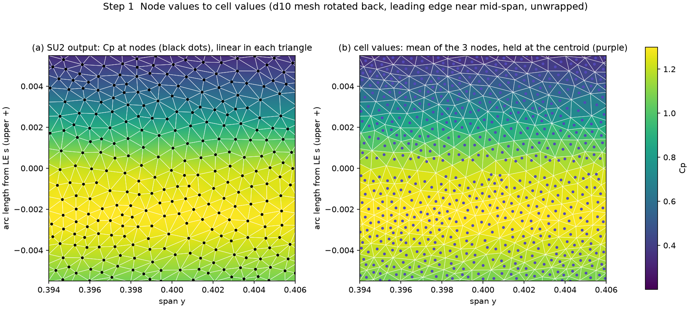
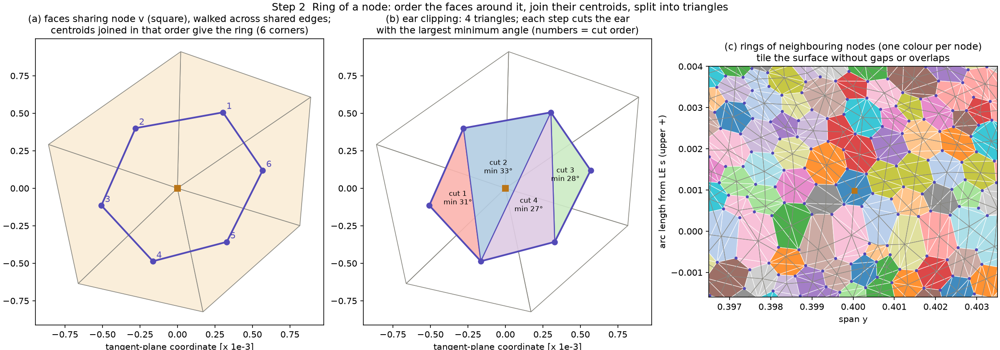
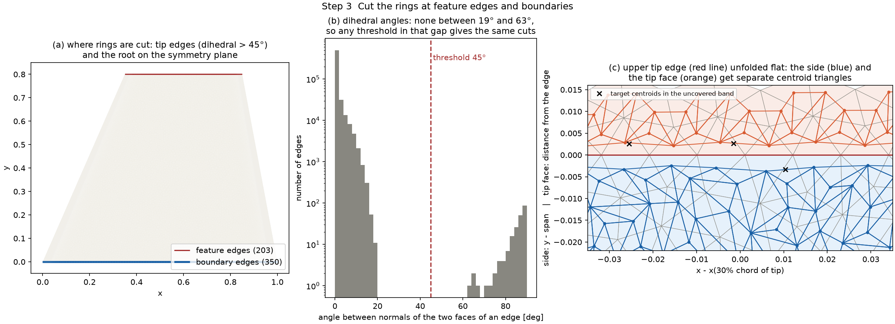
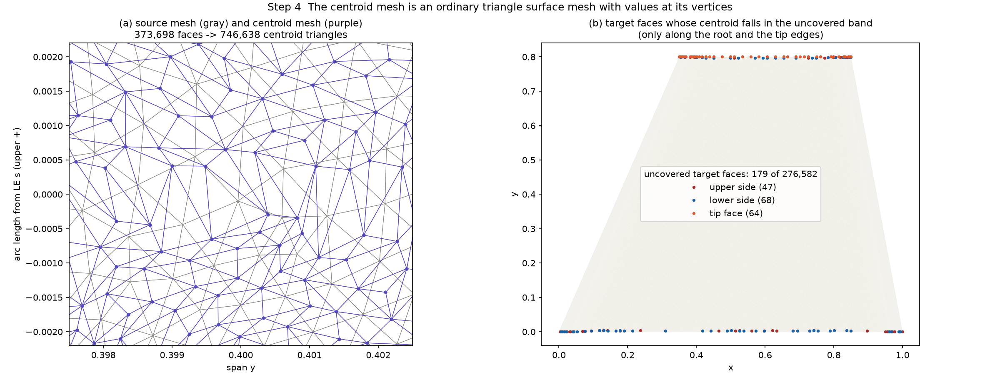
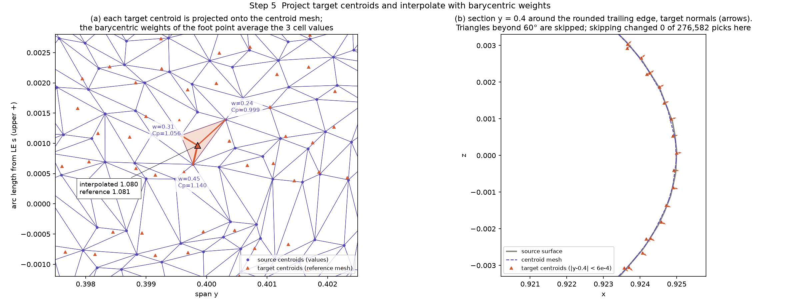
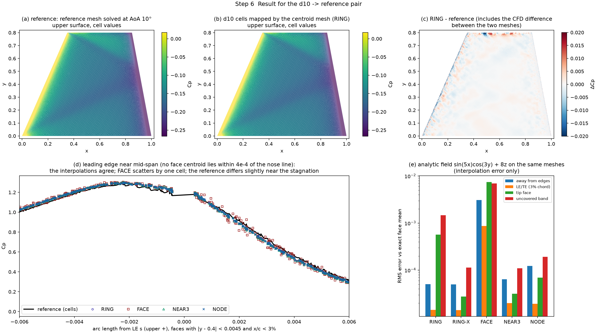

# セル中心の Cp を、つながりから作ったセル中心の三角形格子で補間する検証（全遊動翼単体、SU2 Euler）

作成日: 2026-11-18。状態: **実行済み**（舵角 5°・10° の 2 組）。

補間元も補間先もセル中心の値（三角形ごとの値）のとき、元格子のつながりから「セル中心を頂点とする三角形格子」を作り、そこに補間先の三角形の重心を投影して重心座標で補間する手順を、実際の 3 次元翼のデータで確かめた記録。データは[Cp の補間の検証（2026-11-14）](../20261114-fin-remap-su2/README.md)の SU2 Euler 解析の結果を使う。

SU2 は節点に値を持つので、セル中心の値は節点の Cp を三角形ごとに 3 頂点で平均して作った。セル中心の有限体積法のソルバーが出力する値そのものではない。

## 結論

- セル中心の三角形格子は、翼面（23 万〜37 万面）について 1 秒程度で作れた。三角形に分けられなかった節点の環は 0 個だった。
- 環を切る辺は、翼端の縁（177〜203 本）と翼根の境界（301〜350 本）だけだった。隣り合う面の法線の角度は 21° 以下と 63° 以上にはっきり分かれ、しきい値の 45° はどちらにも近くない。
- 補間前後の法線力 CN と軸力 CA の変化は 0.03% 未満、舵軸まわりのモーメント CMy の変化は 0.09% 未満だった。節点値で補間する従来の方法（NODE）と同じ程度である。
- 基準格子で別に解いた Cp との差（RMS）は、NODE とほぼ同じだった（縁から離れた翼面で 0.0031〜0.0032、前縁・後縁のまわりで 0.0077〜0.0082）。セル値をそのまま写す方法（FACE）は、前縁・後縁のまわりで 1.5 倍大きい。
- 解析的な場で補間の誤差だけを測ると、提案の方法（RING-X）の RMS は縁から離れた翼面で 5e-5〜8e-5 だった。NODE（1.2e-4〜1.5e-4）より小さく、FACE（3.1e-3〜3.6e-3）の 40 分の 1 以下である。
- 補間先の面のうち 0.06〜0.18%（179〜501 面）は、セル中心の三角形格子が覆わない縁の帯に落ちた。すべて翼根と翼端の縁に沿った面である。帯の点を縁の辺の値で埋める（RING）と、帯の中の解析的な場の誤差は、最も近い三角形の平面で線形に外挿する（RING-X）場合の 7〜14 倍になった。RING-X の帯の中の誤差は、帯の外の 2 倍程度である。
- 補間先の面の法線と 60° を超えて向きが違う三角形を候補から外す判定は、外しても選ばれる三角形が 1 つも変わらなかった。表と裏は、セル中心の三角形格子を作る段階で、つながりによって分かれている。
- 法線で絞った最も近い 3 点で補間する方法（NEAR3）は、RMS は同じ程度だが、補間先の面の 37〜45% で外挿になり、重みの絶対値は最大 7.3 だった。

セル中心の値には、`finremap.remap.map_cell_values`（RING-X と同じ手順）を使い、縁の帯に落ちた面（戻り値の 3 つ目）には印を付けておく。

## 手順

舵角 δ の格子（元格子）のセル値を、舵角 0 の基準格子（補間先）の三角形ごとの値にする。

1. 節点の Cp を三角形ごとに 3 頂点で平均し、セル値にする（元格子も基準格子も）。Cp が三角形の中で線形なら、これは面平均に等しい。
2. 元格子の節点を舵軸まわりに −δ 回して、翼固定座標に戻す。
3. 元格子の各節点について、その節点を共有する三角形を辺でたどって並べる（外から見て反時計回り）。それぞれの三角形の重心を順に結ぶと、節点を囲む多角形（節点の環）になる。
4. 境界の辺と特徴線（隣の三角形との法線の角度が 45° を超える辺）では、たどるのをやめて環を切る。切れた環は両端の重心を結んで閉じる。ただし、節点がその線より内側に入る（重心の扇が 180° 以上）環は使わない。
5. 環を、節点の法線に垂直な平面に射影して、耳切りで三角形に分ける。切り落とせる角のうち、三角形の最小角が最大の角から切る。全節点の三角形を集めたものが、セル中心の三角形格子である。
6. 基準格子の各三角形の重心を、セル中心の三角形格子に投影する（最近接点）。候補は重心が近い 24 枚の三角形で、補間先の三角形の法線との角度が 60° を超える三角形は除く。
7. 投影した点の重心座標で、3 つのセル値を平均する。投影した点が格子の縁の辺の上にあるとき（縁の帯）は、その三角形の平面で重心座標を延長する（線形の外挿）。

どの環の辺も隣の節点の環と共有されるので、セル中心の三角形は重ならずに表面を覆う。覆わないのは、境界と特徴線に沿った、幅が三角形の高さの 1/3 程度の帯だけである。

## 比べた手法

| 手法 | 内容 |
|---|---|
| RING | 手順 1〜7。ただし縁の帯の点は、縁の辺の上の値（投影した点の値）を使う |
| RING-X | 手順 1〜7（縁の帯では線形の外挿）。`remap.map_cell_values` と同じ |
| FACE | 補間先の重心を元格子に投影し、投影した点を含む元の三角形のセル値をそのまま使う |
| NEAR3 | 法線の角度が 60° 以内のセル中心のうち最も近い 3 点を選び、その 3 点の平面に射影して重心座標で補間する（外挿を含む） |
| NODE | 節点値のまま補間し（11 月 14 日の手法 D）、基準格子の 3 頂点で平均する。節点値が手に入る場合の参考 |

## 検証の考え方

[11 月 14 日の検証](../20261114-fin-remap-su2/README.md)と同じく、翼単体では「舵角 δ・迎角 0」と「舵角 0・迎角 δ」が同じ流れになることを使う。

- 補間そのものの質は、補間前後の力の変化で見る。力はセル値を三角形ごとに面積分して求める（`remap.integrate_forces_cells`）。3 頂点の平均をセル値にしたので、元格子の力は節点値で積分した値と同じである。
- 基準格子で別に解いた Cp との差には、補間の誤差と、格子の違いによる CFD 解の差の両方が入る。
- 補間の誤差だけを見るため、解析的な場 φ = sin(5x) cos(3y) + 8z（翼固定座標）でも同じ対応を使った。セル値は 7 点の求積（5 次まで厳密）で求めた厳密な面平均で、NODE だけは節点の値 φ を補間した。8z の項は上面と下面で符号が変わり、丸い前縁のまわりで急に変わる。

領域は次の 4 つに分けた。

| 領域 | 内容 | 補間先の面の数 |
|---|---|---|
| 縁から離れた翼面 | 下の 2 つ以外の側面 | 76,580 |
| 前縁・後縁 | 重心が前縁・後縁から翼弦の 3% 以内にある側面 | 198,820 |
| 翼端面 | 翼端の平らな面 | 1,182 |
| 縁の帯 | 上の 3 つのうち、投影した点がセル中心の三角形格子の縁の上にある面 | 179〜501 |

## 共通条件

| 項目 | 値 |
|---|---|
| データ | [11 月 14 日の検証](../20261114-fin-remap-su2/README.md)の SU2 8.5.0 Euler 解析（Mach 2）の表面出力 `surface_flow.vtu`。結果は Git の管理外（`results/finremap/fin-round-m2-20261114/`）にあり、同じ記録の手順で作り直せる |
| 組 | d05-a00 → ref-a05、d10-a00 → ref-a10 |
| 形状 | 台形翼。付け根翼弦 1、翼端翼弦 0.5、翼幅 0.8、最大翼厚比 6%、前縁半径と後縁半径は局所翼弦長の 0.5%、翼端は平らな面 |
| 翼面の三角形の数 | ref 276,582、d05 232,683、d10 373,698 |
| セル値 | 節点の Cp の 3 頂点の平均 |
| 特徴線のしきい値 | 45°（隣の三角形との法線の角度） |
| 候補から外す法線の角度 | 60°（内積 0.5 未満） |
| 投影の候補 | 重心が近い 24 枚の三角形 |
| NEAR3 の候補 | 最も近い 16 点から、法線の条件を満たす近い順に 3 点 |
| 基準量 | 基準面積 0.6、基準長 1、モーメントの基準点は舵軸上の (0.45, 0, 0) |

## 結果

値は [summary.json](summary.json) にある。

### セル中心の三角形格子

| 元格子 | 三角形 | 閉じた環 | 切れた環 | 面が 3 枚未満の環 | 分けられなかった環 | 境界の辺 | 切った特徴線の辺 | セル中心の三角形 |
|---|---|---|---|---|---|---|---|---|
| d05 | 232,683 | 116,015 | 655 | 1 | 0 | 301 | 177 | 464,709 |
| d10 | 373,698 | 186,472 | 756 | 10 | 0 | 350 | 203 | 746,638 |

セル中心の三角形の数は元の三角形の約 2 倍になる。閉じた面なら、節点 V 個・三角形 F 個に対して 3F − 2V 枚である。

縁の帯に落ちた補間先の面は、d05 で 501 面（翼根 243、翼端 258）、d10 で 179 面（翼根 76、翼端 103）だった。元格子が粗い d05 のほうが帯が広い。RING-X の外挿の重みは −0.52〜1.22 の範囲だった。

### 補間前後の力の変化

| 組 | 手法 | CN | CA | CMy | CN の変化 | CA の変化 | CMy の変化 |
|---|---|---|---|---|---|---|---|
| d05 | 元格子（補間前） | 0.18198 | 0.03454 | −0.00877 | | | |
| d05 | RING | 0.18194 | 0.03454 | −0.00876 | −0.022% | −0.015% | −0.078% |
| d05 | RING-X | 0.18194 | 0.03454 | −0.00876 | −0.026% | −0.015% | −0.089% |
| d05 | FACE | 0.18197 | 0.03454 | −0.00877 | −0.008% | −0.012% | −0.020% |
| d05 | NEAR3 | 0.18195 | 0.03454 | −0.00876 | −0.017% | −0.011% | −0.075% |
| d05 | NODE | 0.18196 | 0.03454 | −0.00876 | −0.013% | −0.005% | −0.061% |
| d05 | 基準格子で迎角 5° を解いた解 | 0.18191 | 0.03465 | −0.00872 | | | |
| d10 | 元格子（補間前） | 0.36793 | 0.03486 | −0.01803 | | | |
| d10 | RING | 0.36789 | 0.03485 | −0.01803 | −0.011% | −0.008% | −0.034% |
| d10 | RING-X | 0.36789 | 0.03485 | −0.01803 | −0.012% | −0.008% | −0.038% |
| d10 | FACE | 0.36792 | 0.03485 | −0.01804 | −0.003% | −0.009% | +0.007% |
| d10 | NEAR3 | 0.36788 | 0.03485 | −0.01803 | −0.013% | −0.011% | −0.039% |
| d10 | NODE | 0.36785 | 0.03485 | −0.01802 | −0.022% | −0.019% | −0.063% |
| d10 | 基準格子で迎角 10° を解いた解 | 0.36788 | 0.03475 | −0.01809 | | | |

どの手法も変化は 0.1% 未満で、格子の違いによる CFD 解の差（基準格子の解との差）と同じか、それより小さい。この差だけでは手法の良し悪しは決まらない。

### 基準格子で別に解いた Cp との差（RMS / 最大）

| 組 | 手法 | 縁から離れた翼面 | 前縁・後縁 | 翼端面 | 縁の帯 |
|---|---|---|---|---|---|
| d05 | RING | 0.0032 / 0.048 | 0.0077 / 0.079 | 0.0248 / 0.203 | 0.0128 / 0.116 |
| d05 | RING-X | 0.0032 / 0.048 | 0.0077 / 0.079 | 0.0253 / 0.203 | 0.0148 / 0.121 |
| d05 | FACE | 0.0038 / 0.068 | 0.0119 / 0.151 | 0.0264 / 0.273 | 0.0192 / 0.151 |
| d05 | NEAR3 | 0.0032 / 0.054 | 0.0077 / 0.088 | 0.0249 / 0.203 | 0.0146 / 0.117 |
| d05 | NODE | 0.0032 / 0.044 | 0.0075 / 0.079 | 0.0241 / 0.197 | 0.0140 / 0.116 |
| d10 | RING | 0.0031 / 0.115 | 0.0082 / 0.125 | 0.0172 / 0.147 | 0.0136 / 0.116 |
| d10 | RING-X | 0.0031 / 0.115 | 0.0082 / 0.125 | 0.0179 / 0.147 | 0.0183 / 0.128 |
| d10 | FACE | 0.0037 / 0.165 | 0.0117 / 0.200 | 0.0212 / 0.163 | 0.0236 / 0.180 |
| d10 | NEAR3 | 0.0032 / 0.124 | 0.0083 / 0.128 | 0.0208 / 0.262 | 0.0172 / 0.113 |
| d10 | NODE | 0.0031 / 0.060 | 0.0080 / 0.078 | 0.0186 / 0.153 | 0.0171 / 0.124 |

- RMS は RING、RING-X、NEAR3、NODE でほぼ同じで、CFD 解の差が大部分を占める。
- d10 の縁から離れた翼面の最大差は、RING が 0.115、NODE が 0.060 だった。どの手法でも、最大差の面は翼端の縁に接する下面の前縁寄り（x/c ≈ 0.035、y ≈ 0.8）にある。縁をまたいで圧力が急に変わる所で、節点値は翼端面と側面に共有されるが、セル値は片側の面だけから補間するため、表し方の違いが出る。
- 縁の帯では、RING-X の差が RING より少し大きかった（d10 で RMS 0.0136 と 0.0183）。帯は翼根と翼端の縁で、CFD 解そのものの差も大きい所である。

### 解析的な場の補間の誤差（RMS / 最大）

| 組 | 手法 | 縁から離れた翼面 | 前縁・後縁 | 翼端面 | 縁の帯 |
|---|---|---|---|---|---|
| d05 | RING | 8.0e-5 / 9.6e-4 | 3.5e-5 / 4.7e-4 | 7.6e-4 / 8.6e-3 | 1.2e-3 / 8.6e-3 |
| d05 | RING-X | 7.9e-5 / 8.0e-4 | 3.5e-5 / 4.8e-4 | 4.3e-5 / 3.4e-4 | 1.7e-4 / 6.7e-4 |
| d05 | FACE | 3.6e-3 / 3.4e-2 | 1.1e-3 / 5.8e-3 | 7.8e-3 / 5.2e-2 | 6.8e-3 / 3.5e-2 |
| d05 | NEAR3 | 9.4e-5 / 1.1e-3 | 3.6e-5 / 6.0e-4 | 4.5e-5 / 4.6e-4 | 1.5e-4 / 6.7e-4 |
| d05 | NODE | 1.5e-4 / 9.3e-4 | 3.0e-5 / 3.1e-4 | 9.0e-5 / 4.5e-4 | 2.3e-4 / 8.9e-4 |
| d10 | RING | 5.1e-5 / 9.9e-4 | 1.4e-5 / 3.0e-4 | 5.7e-4 / 1.0e-2 | 1.5e-3 / 1.0e-2 |
| d10 | RING-X | 5.0e-5 / 5.8e-4 | 1.4e-5 / 3.0e-4 | 2.8e-5 / 2.6e-4 | 1.1e-4 / 4.6e-4 |
| d10 | FACE | 3.1e-3 / 3.4e-2 | 8.6e-4 / 5.6e-3 | 7.4e-3 / 4.1e-2 | 7.0e-3 / 3.5e-2 |
| d10 | NEAR3 | 6.4e-5 / 9.9e-4 | 2.0e-5 / 6.8e-4 | 3.2e-5 / 2.5e-4 | 1.1e-4 / 5.5e-4 |
| d10 | NODE | 1.2e-4 / 7.5e-4 | 1.9e-5 / 1.6e-4 | 7.0e-5 / 2.9e-4 | 1.9e-4 / 6.1e-4 |

- 帯の外では、RING と RING-X は同じ値で、RMS は NODE より小さい。NODE は補間先の 3 頂点で補間してから平均するので、面平均を直接補間する RING より誤差が少し大きい。
- RING の翼端面と縁の帯の誤差は、帯の点を縁の辺の値で埋めるためである。翼端面は細長く、周りがすべて特徴線なので、帯の割合が大きい。RING-X ではこの誤差が翼端面で 18〜20 倍、縁の帯で 7〜14 倍小さくなった。
- FACE は 1 次精度なので、誤差が 1〜2 桁大きい。
- NEAR3 の RMS は RING-X に近いが、最大誤差は前縁・後縁で RING-X の 1.3〜2.3 倍だった。

### 法線の判定と NEAR3 の外挿

- 補間先の三角形の法線との角度で候補を外す判定をやめても、選ばれる三角形は 2 組とも 1 つも変わらなかった（276,582 面中 0 面）。セル中心の三角形は、同じ節点を共有する面の重心だけを結ぶので、上面と下面、側面と翼端面を結ぶ三角形がそもそもない。判定は、薄い形状で投影先が反対側になるのを防ぐ保険として残した。
- NEAR3 では、補間先の面の 37%（d05、101,228 面）と 45%（d10、123,295 面）で、補間先の点が 3 点の三角形の外にあり、外挿になった。重みの絶対値の最大は 4.5 と 7.3 だった。Gmsh の格子は規則的に近いので、平面のランダムな格子で試したとき（最大 212）ほどは大きくならない。

### 計算時間

精度の結論とは別の観測。Mac mini（Apple M5 Pro）の CPU で、numpy と scipy を 1 プロセスで実行した（PyTorch は使っていない）。セル中心の三角形格子の作成は d05 で 0.7 秒、d10 で 1.1 秒。補間を含めた時間は次のとおり。

| 組 | RING（格子の作成を含む） | FACE | NEAR3 | NODE |
|---|---|---|---|---|
| d05 | 2.2 s | 1.5 s | 0.5 s | 0.8 s |
| d10 | 2.7 s | 1.6 s | 0.5 s | 0.9 s |

## 図（舵角 10° の組）

前縁まわりの図は、前縁を開いた座標で描いた。横軸は翼幅 y、縦軸は前縁からの近似弧長 s = sign(z)·a0·c·√(x/c)（前縁の近くでは z に等しく、上面が正）である。

### ステップ 1：節点値からセル値へ



(a) は SU2 の出力で、Cp は節点（黒い点）にあり、三角形の中で線形に変わる。(b) は 3 頂点の平均をセル値にしたもので、値は三角形の中で一定になり、重心（紫の点）に置く。補間元も補間先も、この形の値を扱う。

### ステップ 2：節点の環



(a) 節点 v（四角）を共有する 6 枚の三角形を、辺を共有する順にたどり、重心を番号の順に結ぶと環になる。(b) 環を耳切りで 4 枚の三角形に分ける。番号は切り落とした順で、各段階で最小角が最大の耳を選ぶ。(c) 近くの節点の環を節点ごとに色分けした。環は隙間なく並び、重ならない。

### ステップ 3：特徴線と境界で環を切る



(a) 環を切る辺は、翼端の縁（赤、二面角が 45° を超える辺）と翼根の境界（青）だけである。(b) 隣り合う面の法線の角度は 19° 以下と 63° 以上に分かれており（d05 では 21° 以下と 63° 以上）、しきい値をこの間のどこに置いても同じ辺が切られる。10° を超える 19° 以下の辺は、すべて前縁・後縁から翼弦の 3% 以内にある丸みの格子の折れで、63° 以上は翼端の縁である。(c) 翼端の上面側の縁（赤い線）を平らに開いた図。側面（青）と翼端面（橙）は別々のセル中心の三角形になり、縁に沿った細い帯は覆われない。× はこの帯に落ちた補間先の重心である。

### ステップ 4：セル中心の三角形格子



(a) 元格子（灰色）とセル中心の三角形格子（紫）。セル中心の三角形格子は普通の三角形の表面格子で、頂点にセル値を持つ。そのため、節点値の補間に使ってきた `map_barycentric` をそのまま使える。(b) 縁の帯に落ちた補間先の面（179 面）。翼根と翼端の縁だけにある。

### ステップ 5：投影と重心座標



(a) 補間先の重心（橙の三角）をセル中心の三角形格子に投影し、投影した点を含む三角形（橙の塗り）の重心座標で 3 つのセル値を平均する。この面では、重み 0.31、0.24、0.45 で 1.080 になり、基準格子で別に解いた値は 1.081 だった。(b) 丸い後縁を通る断面 y = 0.4。元の表面（灰色）とセル中心の三角形格子（紫の破線）はほぼ重なり、投影距離は中央値 4e-7 だった。矢印は補間先の面の法線である。

### ステップ 6：結果



(a)(b) 上面の Cp のセル値。基準格子で迎角 10° を解いた解と、d10 の解を RING で補間したもの。(c) 差。前縁と翼端の縁に沿った差は、格子の違いによる CFD 解の差を含む。(d) 翼幅中央の前縁まわりの分布。前縁の線から 4e-4 以内には補間先の面の重心がないので、線が途切れる。RING、NEAR3、NODE はほぼ重なり、FACE は 1 セル分ばらつく。(e) 解析的な場の誤差（RMS）。RING-X は、帯の外でも帯の中でも NODE 以下である。

## 注意点と未確認のこと

- セル値は SU2 の節点値から作った。セル中心のソルバーの壁面の値（壁の面の値か、壁に接するセルの中心の値か）を直接読んで試してはいない。
- 翼端の縁のように、縁をまたいで圧力が急に変わる所では、節点値とセル値で表し方が違うので、最大差が NODE より大きく出る。
- 保存型ではない。この翼では力の変化は 0.1% 未満だったが、Cp を面積で積分した量が保たれる保証はない。
- 丸い前縁・後縁は、半周を 12〜16 セル程度で表している。半径を 1〜2 セルでしか表さない格子では試していない。
- 四角形の面は、`vtu.Mesh.triangles` で 2 枚の三角形に分けてセル値を写せば同じ手順が使えるはずだが、試していない。
- 胴体付きの形状のように、1 本の辺を 3 枚以上の三角形が共有する格子では、その辺で環を切る（`centroid_mesh` は自動で切る）。部位ごとに分ける場合は `part` を渡す。試したのは翼単体だけである。

## スクリプトの使い方

コマンドはリポジトリのルートで実行する。numpy、scipy、matplotlib が要る。データは[11 月 14 日の記録](../20261114-fin-remap-su2/README.md#スクリプトの使い方)の手順で作る。

```sh
# 補間と比較（summary.json を書き、図に使う配列を Git の管理外に保存する）
python3 docs/reports/20261118-cell-centered-remap/cell_remap.py results/finremap/fin-round-m2-20261114 \
    --arrays results/finremap/cell-remap-20261118 > docs/reports/20261118-cell-centered-remap/summary.json
# 図（舵角 10° の組）
python3 docs/reports/20261118-cell-centered-remap/figures.py results/finremap/cell-remap-20261118/d10-a00.npz \
    results/finremap/fin-round-m2-20261114/plan.json docs/reports/20261118-cell-centered-remap
```

自分のデータに使うときは、`finremap.remap` の関数を直接呼ぶ。

```python
from finremap import remap

src_cell = remap.cell_values(src_tri, src_cp_nodes)        # 節点値からセル値を作る場合
q = dst_points[dst_tri].mean(axis=1)                       # 補間先の三角形の重心
qn, _ = remap.face_normals_areas(dst_points, dst_tri)      # 補間先の三角形の法線（外向き）
val, dist, band = remap.map_cell_values(src_points, src_tri, src_cell, q, qn)
```

三角形は外向きにそろえておく（`remap.orient_outward`）。`band` は縁の帯に落ちた面で、値は線形の外挿になっている。

| ファイル | 内容 |
|---|---|
| [cell_remap.py](cell_remap.py) | セル値への変換、5 つの手法での補間、力と差の集計、解析的な場の試験 |
| [figures.py](figures.py) | 各ステップの図 |
| [summary.json](summary.json) | 集計した値 |
| `finremap/remap.py` | `cell_values`、`centroid_mesh`、`map_cell_values`、`plane_barycentric`、`boundary_foot`、`integrate_forces_cells` を追加した |
