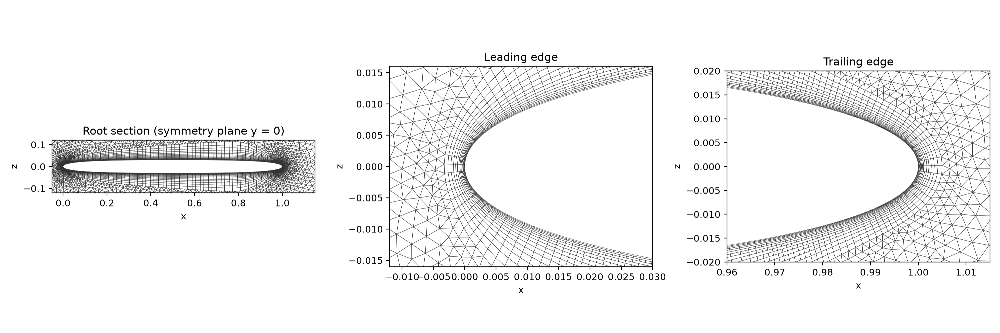
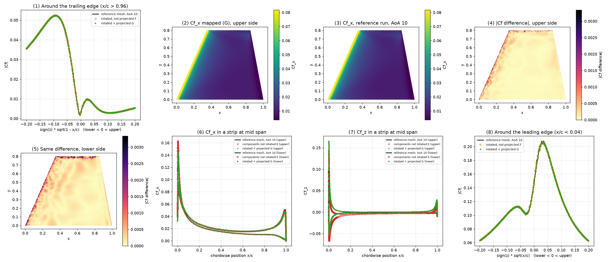

# プリズム層を付けた格子での Cf の補間の検証（全遊動翼単体、SU2 層流）

作成日: 2026-11-19。状態: **4 ケースとも実行済み**（d10-a00 は、格子を軽くして作り直してから実行した。[実行したケース](#実行したケース)）。同じ日に、圧力の差の切り分けのためのケース ref2-a05 と rot05-a00 を、11 月 19〜20 日に制限関数を外したケース ref-a05-nolim と rot05-a00-nolim を追加で実行した（[格子だけを変えた解との比較](#格子だけを変えた解との比較切り分け)、[箱ごと回した格子の解との比較](#箱ごと回した格子の解との比較座標系の切り分け)、[制限関数を外した解の比較](#制限関数を外した解の比較原因の確認)）。

[11 月 17 日の層流の記録](../20261117-fin-cf-remap-laminar/README.md)と同じ翼・流れの条件・翼面の格子幅で、翼面にプリズム層（境界層格子）を付けた格子を使い、摩擦係数 Cf を基準格子へ補間する手順を確かめ直した。11 月 17 日の格子は四面体だけで、境界層を解像していなかった。

確かめるのは補間と積分の手順と、格子による Cf の差がどれだけ縮むかである。Cf の値そのものは、レイノルズ数 5,000 の層流という仮の条件の値であり、実機の流れの解ではない。

## 結論

- **補間の手順の結論は変わらない**。成分を回して補間し接平面へ射影する方法（手法 G）で、補間前後の摩擦軸力の変化は 0.011% 以下、Cp の法線力の変化は 0.022% 以下だった（11 月 17 日はそれぞれ 0.02% 以下と 0.01% 以下）。
- **基準格子で別に解いた Cf との差は、2 桁小さくなった**。摩擦軸力の差は −0.06% と −0.04%（11 月 17 日は −3.1% と +3.2%）。Cf の差ベクトルの RMS は、基準格子の |Cf| の RMS の 1.7% と 1.3%（同じく 7.3% と 7.1%）。11 月 17 日の約 3% の差は、主に境界層を解像していない格子による差だった。
- **Cf の大きさは、四面体だけの格子の約 2.3 倍になった**。摩擦分の CFx は 0.0465〜0.0475 で、11 月 17 日の 0.020〜0.021 の約 2.3 倍である。平板の層流（Blasius）で見積もると約 0.043 なので、プリズム層の値は見積もりの 1 割増しの範囲にあり、11 月 17 日の値は半分以下だった。11 月 17 日の記録の Cf の値は使えない（補間の手順の結論は使える）。
- **粘性応力の法線成分 τ_nn は小さくなった**。接線成分に対する RMS の比は 0.019〜0.023 で、11 月 17 日の 0.086〜0.096 の 1/4〜1/5。SU2 の摩擦分に入る法線分は、摩擦分の CFx の 0.2% 以下になった。
- **圧力の法線力は、別に解いた解と 0.8〜0.9% 違う**。補間した Cp の法線力は、基準格子で別に解いた解より 0.93%（舵角 5°）と 0.76%（舵角 10°）小さい。11 月 17 日（0.35% と 0.48%）より大きく、Euler（0.1% 未満）よりずっと大きい。差の約 8 割は翼弦の 30〜70% から来ていて、上面・下面とも法線力を減らす向きにそろっている。
- **その圧力の差は、格子の違いでは説明できない**。基準格子と同じ設定で格子幅だけを 1% 変えた舵角 0° の格子（ref2）を迎角 5° で解き、基準格子へ補間すると、基準の解との法線力の差は −0.016% だった（Cp の差の RMS は 0.0025 で、舵角を付けた組の 0.0030・0.0027 と同じ程度）。ref2 の四面体の最小 SICN は 0.074 で、d05 と同じ程度に悪い。
- **圧力の差は、ソルバーの座標系で生じている**。基準格子を計算領域の箱ごと 5° 回した格子（rot05）を迎角 0° で解くと、翼から見た格子・箱・一様流は ref-a05 と全く同じなのに、法線力は ref-a05 より 1.03% 小さく、翼弦の中央に集まる同じ形の差が出た。一方、rot05-a00 と d05-a00（一様流の向きが同じで、箱の向きと格子が違う）の差は 0.10% だった。SU2 のこの設定の解は、一様流が格子の座標軸に対してどちらを向くかで約 1% 変わる。補間の手順の誤差ではない。
- **座標系への依存の原因は、制限関数である**。Venkatakrishnan の制限関数を外して（`SLOPE_LIMITER_FLOW= NONE`、ほかは同じ）ref-a05 と rot05-a00 を解き直すと、2 つの解の法線力の差は 0.000%、Cp の差の RMS は 0.00002 になった（制限関数ありでは −1.03%、0.0006）。SU2 の CL も 8 桁一致した。制限関数なしの解は 3,000 反復で収束しきっていない（密度残差 −6.2 と −6.4）が、2 つの解は反復ごとにほぼ同じ値をたどった。制限関数のあるなしで、法線力そのものも 0.4〜0.6% 変わる（[注意点](#注意点と未確認のこと)）。

## 共通条件

| 項目 | 値 |
|---|---|
| 形状 | 11 月 14 日・17 日と同じ台形翼。付け根翼弦 1、翼端翼弦 0.5、翼幅 0.8、最大翼厚比 6%、前縁半径と後縁半径は局所翼弦長の 0.5% |
| 舵軸 | y 軸に平行で (x, z) = (0.45, 0) を通る |
| 解析 | SU2 8.5.0、層流の Navier–Stokes（乱流モデルなし）、Mach 2、Roe＋MUSCL、Venkatakrishnan の制限関数（係数 0.05、400 反復目で固定。-nolim の 2 ケースだけ制限関数なし）、陰解法、CFL の自動調整（初期 5、上限はケースごと） |
| レイノルズ数 | 5,000（付け根翼弦基準） |
| 粘性係数 | 0.16674 Pa·s で一定（一様流の圧力 101,325 Pa、温度 288.15 K） |
| 熱伝導 | プラントル数 0.72 で一定 |
| 翼面 | 断熱壁 |
| 収束判定 | 密度残差の常用対数が −8 以下。反復の上限 8,000（-nolim の 2 ケースは 3,000） |
| 基準量 | 基準面積 0.6、基準長 1、モーメントの基準点は舵軸上の (0.45, 0, 0) |
| 格子 | Gmsh 4.15.2。翼面の三角形格子は 11 月 17 日と同じ設定で作り、15 層のプリズム層を押し出して、外側を四面体（HXT）で埋めた |
| 補間と比較 | 11 月 17 日と同じ（Cp は手法 D、Cf は手法 E・F・G）。`finremap` の `analyze` |
| 計算機 | Mac mini（メモリ 24 GB）、Open MPI 5.0.9、ホストの SU2（イメージなし）、`--backend local` |

設定は [case.cfg](case.cfg)（ref-a10 のもの）。ケースごとに違うのは、格子、迎角（`AOA`）、d10-a00 の CFL の上限と途中出力の間隔だけである。

### プリズム層

設定は `meshes.boundary_layer` の既定値（層の数 15、公比 1.2）。作り方と各項目は [`finremap` の説明](../../fin-remap/README.md#プリズム層境界層格子)にある。

- 層全体の厚さ T は、翼固定座標で 7√(x ν/U)（x は局所前縁からの距離）。下限 0.003。後縁から翼弦の 20% の範囲で、後縁の 0.005 まで滑らかに減らした。
- 最初の層の高さは 4.5×10⁻⁵〜1.2×10⁻³（T の範囲 0.0031〜0.086）。平板の層流境界層の厚さ 5√(x ν/U) は、後縁で約 0.07 である。
- 舵角は、翼面の節点を翼固定座標に戻してから厚さと押し出す向きを決め、元の向きへ回して置いた。



付け根の断面（対称面）の ref 格子。左が全体、中央が前縁、右が後縁のまわり。後縁のまわりでは層を薄くしてあり、境界層の外側の部分は四面体の領域に入る。図は [mesh_figure.py](mesh_figure.py) で作った。

## 格子

| 格子 | 舵角 [deg] | 翼面の格子幅 | 縁まわりの格子幅 | 2 次元アルゴリズム | 翼面の節点数 | 全節点数 | プリズム数 | 四面体数 | 四面体の最小 SICN | 使ったケース |
|---|---|---|---|---|---|---|---|---|---|---|
| ref | 0 | 0.012 | 0.0010 | 6 | 138,453 | 2,330,278 | 4,148,730 | 1,077,453 | 0.167 | ref-a05、ref-a10 |
| d05 | 5 | 0.013 | 0.0011 | 6 | 116,493 | 1,968,882 | 3,490,245 | 958,589 | 0.073 | d05-a00 |
| d10 | 10 | 0.011 | 0.00095 | 6 | 152,718 | 2,564,428 | 4,576,380 | 1,150,601 | 0.044 | d10-a00 |
| d10（旧） | 10 | 0.011 | 0.0009 | 5 | 187,025 | 3,120,170 | 5,605,470 | 1,275,179 | 0.074 | d10-a00 の試行 1・2（中止） |
| ref2 | 0 | 0.0121 | 0.00101 | 6 | 136,188 | 2,292,918 | 4,080,780 | 1,064,366 | 0.074 | ref2-a05（切り分け） |
| rot05 | 5 | 0.012 | 0.0010 | 6 | 138,453 | 2,330,278 | 4,148,730 | 1,077,453 | 0.167 | rot05-a00（切り分け。ref の全節点を箱ごと 5° 回した） |

- ref と d05 の翼面の三角形格子は、11 月 14 日・17 日の格子と同じ（節点数と三角形数が一致）。
- d10 は、11 月 14 日・17 日と同じ設定（旧）で作ったが、3.1M 節点では 24 GB のメモリに収まらずスワップした。縁まわりの格子幅を 0.0009 → 0.00095、2 次元アルゴリズムを 5 → 6 に変えて作り直した。翼面と縁まわりの格子幅は、どちらも基準格子より細かいままである。**舵角 10° の組は、11 月 14 日・17 日と同じ翼面格子ではない**。
- プリズムの品質の指標（`mesh.json` の `prism_stats`）: 押し出す向きと面の法線の内積の最小 0.48〜0.51、各層の三角形の法線と元の面の法線の内積の最小 0.66〜0.68、プリズムを 3 つの四面体に分けた体積の比の最小 0.48〜0.50（3 つの格子の範囲）。裏返った要素はない。SU2 は「すべての要素の向きが正しい」と出力した。

## 実行したケース

設定（実行したもの）。迎角以外の流れの条件は共通条件のとおり。

| ケース | 格子 | 迎角 [deg] | 制限関数 | MPI 並列数 | CFL の上限 | 反復の上限 | 途中出力の間隔 [反復] |
|---|---|---|---|---|---|---|---|
| ref-a05 | ref | 5 | あり | 12 | 50 | 8,000 | 8,000（最後だけ） |
| d05-a00 | d05 | 0 | あり | 12 | 50 | 8,000 | 8,000 |
| ref-a10 | ref | 10 | あり | 12 | 50 | 8,000 | 8,000 |
| d10-a00（試行 1） | d10（旧） | 0 | あり | 12 | 50 | 8,000 | 8,000 |
| d10-a00（試行 2） | d10（旧） | 0 | あり | 8 | 20 | 8,000 | 500 |
| d10-a00 | d10 | 0 | あり | 8 | 20 | 8,000 | 500 |
| ref2-a05 | ref2 | 5 | あり | 12 | 50 | 8,000 | 8,000 |
| rot05-a00 | rot05 | 0 | あり | 12 | 50 | 8,000 | 8,000 |
| ref-a05-nolim（試行 1） | ref | 5 | なし | 12 | 50 | 8,000 | 8,000（最後だけ） |
| ref-a05-nolim | ref | 5 | なし | 12 | 50 | 3,000 | 500 |
| rot05-a00-nolim | rot05 | 0 | なし | 12 | 50 | 3,000 | 500 |

結果。CL・CD・CMy は SU2 の履歴の最後の値（CMy は舵軸まわり）。

| ケース | 結果 | 反復数 | 密度残差（log10） | CL | CD | CMy |
|---|---|---|---|---|---|---|
| ref-a05 | converged | 2,155 | −8.00 | 0.16630 | 0.09958 | −0.00592 |
| d05-a00 | converged | 2,194 | −8.00 | 0.16491 | 0.09944 | −0.00577 |
| ref-a10 | converged | 2,214 | −8.00 | 0.33374 | 0.14393 | −0.01283 |
| d10-a00（試行 1） | 中止 | 2,267 | −5.23 | 0.33175 | 0.14355 | −0.01259 |
| d10-a00（試行 2） | 中止 | 数反復 | — | — | — | — |
| d10-a00 | converged | 3,568 | −8.00 | 0.33147 | 0.14351 | −0.01254 |
| ref2-a05 | converged | 2,128 | −8.00 | 0.16630 | 0.09958 | −0.00597 |
| rot05-a00 | converged | 2,138 | −8.00 | 0.16475 | 0.09944 | −0.00574 |
| ref-a05-nolim（試行 1） | 中止 | 633 | −6.00 | 0.16542 | 0.09832 | −0.00535 |
| ref-a05-nolim | unconverged | 3,000 | −6.18 | 0.16552 | 0.09873 | −0.00539 |
| rot05-a00-nolim | unconverged | 3,000 | −6.42 | 0.16552 | 0.09873 | −0.00539 |

- d10-a00 の試行 1 は、密度残差が −7.8 まで下がった後、CFL が上限 50 に達するたびに −5 台まで戻る振動を繰り返した。スワップで 1 反復 25 秒まで遅くなったため、2,267 反復で止めた。解は保存されていない（途中出力なし）。履歴の力係数は、止める前の 1,000 反復で CL が 0.01%、CD が 0.08% 変化していた。
- d10-a00 の試行 2 は、上の設定で始めた直後に、格子を作り直すことにして止めた。
- d10-a00 は CFL の上限を 20 にしてから、600 反復目以降、残差が 0.05 を超えて戻ることなく下がった。
- 制限関数なしの 2 ケースは、CFL が下限の 5 からほとんど上がらなかった（制限関数ありの ref-a05 は 50 まで上がった）。密度残差は 500 反復目までに −6 近くまで下がった後、上下しながら少しずつ下がり、最後の 500 反復では −6.0〜−6.85 の間を上下して、3,000 反復で −8 に届かなかった（終わりの値 −6.18 と −6.42 の違いは、この上下のどこで止まったかの違い）。最後の 1,000 反復で CL は 0.002%、CD は 0.11% 変化した（CD はまだ増えている）。ref-a05-nolim の試行 1 は、反復の上限 8,000・途中出力なしのままだと 3 時間近く解が保存されないので、633 反復で止めた。

SU2 が出力した力の内訳（格子の座標系）。

| ケース | CFx 圧力分 | CFx 摩擦分 | CFz 圧力分 | CFz 摩擦分 | CMy 圧力分 | CMy 摩擦分 |
|---|---|---|---|---|---|---|
| ref-a05 | 0.03719 | 0.04753 | 0.17316 | 0.00118 | −0.00584 | −0.00008 |
| d05-a00 | 0.05201 | 0.04743 | 0.16768 | −0.00277 | −0.00567 | −0.00010 |
| ref-a10 | 0.03730 | 0.04649 | 0.35133 | 0.00234 | −0.01269 | −0.00015 |
| d10-a00 | 0.09727 | 0.04624 | 0.33696 | −0.00549 | −0.01236 | −0.00018 |
| ref2-a05 | 0.03719 | 0.04752 | 0.17316 | 0.00118 | −0.00589 | −0.00008 |
| rot05-a00 | 0.05198 | 0.04746 | 0.16749 | −0.00274 | −0.00564 | −0.00011 |
| ref-a05-nolim | 0.03626 | 0.04767 | 0.17242 | 0.00107 | −0.00534 | −0.00005 |
| rot05-a00-nolim | 0.05115 | 0.04758 | 0.16861 | −0.00309 | −0.00534 | −0.00005 |

### 計算時間とメモリ（性能の観測）

精度の結論とは別の観測である。メモリは、SU2 の全プロセスの RSS の合計を 20 秒ごとに記録した最大値で、共有分を重ねて数え、OS の圧縮とスワップで変わる。`PYTORCH_ENABLE_MPS_FALLBACK` は関係しない（PyTorch を使っていない）。

| ケース | 全節点数 | MPI 並列数 | 反復数 | 計算時間 [s] | RSS の合計の最大 [GB] |
|---|---|---|---|---|---|
| ref-a05 | 2,330,278 | 12 | 2,155 | 3,152 | 13.6 |
| d05-a00 | 1,968,882 | 12 | 2,194 | 2,211 | 14.0 |
| ref-a10 | 2,330,278 | 12 | 2,214 | 3,907 | 13.1 |
| d10-a00（試行 1） | 3,120,170 | 12 | 2,267（中止） | 11,448 | 17.1 |
| d10-a00 | 2,564,428 | 8 | 3,568 | 8,798 | 14.6 |
| ref2-a05 | 2,292,918 | 12 | 2,128 | 2,682 | 13.4 |
| rot05-a00 | 2,330,278 | 12 | 2,138 | 2,710 | 13.4 |
| ref-a05-nolim（試行 1） | 2,330,278 | 12 | 633（中止） | 676 | 14.0 |
| ref-a05-nolim | 2,330,278 | 12 | 3,000 | 3,415 | 14.0 |
| rot05-a00-nolim | 2,330,278 | 12 | 3,000 | 2,915 | 14.0 |

- 11 月 17 日（四面体だけ、0.4〜0.65M 節点）は 4 ケースとも 450〜480 反復、136〜222 秒だった。プリズム層を付けると、反復数が約 5 倍（d10-a00 は約 7 倍）、1 反復の時間が約 4〜5 倍になった。
- d10-a00 の試行 1 は、1 反復 5 秒前後から、スワップが 11 GB を超えたところで 25 秒まで遅くなった。
- d10-a00 の計算中も、システム全体のスワップ使用量は 12 GB 前後だったが、1 反復 2.5 秒前後で進んだ。8 並列にした分、遅い。
- スワップの多くは SU2 のものではなかった可能性が高い。全ケースが終わり SU2 が動いていない 19:48 に、スワップ使用量は 11.3 GB のままだった。このとき、動画デコード用のシステムサービス（VTDecoderXPCService、13:47 起動）のメモリフットプリントは 16 GB あった。システムのログでは、このサービスを起動したのは動く壁紙（Aerial）の拡張機能で、13:47 から 30 フレーム/秒で動画を再生し続けていた。このサービスは 19:54 には 23 MB に戻り、スワップ使用量も 5.3 GB に減った。計算中のこのプロセスの大きさは記録していない。ほかに仮想マシンのサービスが約 2 GB（圧縮分を別に約 3.5 GB）、固定メモリが約 3 GB あった。
- 格子生成は 1 スレッドで ref 80 秒、d05 70 秒、d10 109 秒（旧 127 秒）、ref2 81 秒、最大 RSS 2.4〜2.9 GB（ref2 は測っていない）。
- ref2-a05 を解いたとき（20:08〜20:52）は、動画デコードのサービスが小さくなっていて（336 MB）、スワップの使用量は計算の前に 5.2 GB だった。
- 制限関数なしの 2 ケースは、1 反復 1.14 秒と 0.97 秒で、制限関数ありの ref-a05（1.46 秒）と rot05-a00（1.27 秒）より短い。試行 1 と ref-a05-nolim のメモリは、続けて記録した 1 つのログの最大値である。

## 結果

値は [summary.json](summary.json) にある。

### 積分と SU2 の内訳の照合

| 元のケース | 成分 | 圧力分（SU2） | 圧力分（積分） | 摩擦分（SU2） | 摩擦分（積分） |
|---|---|---|---|---|---|
| d05-a00 | CFx | 0.05201 | 0.05201 | 0.04743 | 0.04746 |
| d05-a00 | CFz | 0.16768 | 0.16768 | −0.00277 | −0.00298 |
| d05-a00 | CMy | −0.00567 | −0.00567 | −0.00010 | −0.00008 |
| d10-a00 | CFx | 0.09727 | 0.09727 | 0.04624 | 0.04621 |
| d10-a00 | CFz | 0.33696 | 0.33696 | −0.00549 | −0.00581 |
| d10-a00 | CMy | −0.01236 | −0.01237 | −0.00018 | −0.00015 |

- 圧力分は小数第 5 位まで一致した（11 月 17 日と同じ）。
- 摩擦分の CFx の差は 0.07% 以下。CFz の差（0.00021 と 0.00032）は、次の節の法線分と節点面積の取り方で説明できる。

### 粘性応力の法線成分

11 月 17 日と同じ方法で、restart の解と体積格子から壁面の速度勾配を計算し直し、τ·n を接線成分と法線成分に分けた。スクリプトは [friction_check.py](friction_check.py)（11 月 17 日のものに、プリズムの辺を読む処理を足した）、値は [friction_check.json](friction_check.json) にある。

計算し直した接線応力と、SU2 が出力した Cf の差は、4 ケースとも RMS で 0.3% だった。接線分と法線分の和は、SU2 の内訳と 1e-6 以内で一致した。

| ケース | τ_nn / τ_t（RMS） | SU2 の CFx 摩擦分 | うち法線分 | SU2 の CFz 摩擦分 | うち法線分 | 11 月 17 日の τ_nn / τ_t | 11 月 17 日の CFz の法線分 |
|---|---|---|---|---|---|---|---|
| ref-a05 | 0.020 | 0.047525 | 0.000021 | 0.001183 | 0.000046 | 0.090 | 0.000244 |
| d05-a00 | 0.019 | 0.047427 | 0.000034 | −0.002767 | 0.000236 | 0.096 | 0.000264 |
| ref-a10 | 0.023 | 0.046494 | 0.000025 | 0.002335 | 0.000090 | 0.094 | 0.000454 |
| d10-a00 | 0.023 | 0.046239 | 0.000095 | −0.005486 | 0.000363 | 0.086 | 0.000439 |

- τ_nn は、本来は 0 になる量で（[11 月 17 日の記録](../20261117-fin-cf-remap-laminar/README.md#どう積分するのが正しいか)）、接線応力に対する比が 0.086〜0.096 から 0.019〜0.023 に下がった。壁面の勾配の解像が良くなった目安である。
- 力に入る法線分は、基準格子では CFz で 1/5 になったが、舵角を付けた格子ではあまり減っていない（0.00026 → 0.00024、0.00044 → 0.00036）。翼の上下で打ち消し合う程度の違いと考えているが、確かめていない。d10 は 11 月 17 日と翼面格子が違う。
- x 成分は、法線分を除いた接線分だけで比べても、SU2 の節点の求積は三角形ごとの積分より 0.1〜0.15% 小さい。11 月 17 日と同じく、節点面積の取り方による。

### 摩擦の大きさ（四面体だけの格子との比較）

SU2 の摩擦分の CFx（格子の座標系）。

| ケース | プリズム層あり | 四面体だけ（11 月 17 日） | 比 |
|---|---|---|---|
| ref-a05 | 0.04753 | 0.02053 | 2.32 |
| d05-a00 | 0.04743 | 0.01988 | 2.39 |
| ref-a10 | 0.04649 | 0.02012 | 2.31 |
| d10-a00 | 0.04624 | 0.02077 | 2.23 |

平板の層流の平均摩擦係数 1.328/√Re_c（Re_c は局所翼弦のレイノルズ数）を、翼幅方向に積分して両面を足すと、CFx は 2 × 1.328 / √5000 / 0.6 × ∫√c dy ≈ 0.043 になる（∫√c dy = 0.690）。プリズム層の値はこの 1.07〜1.10 倍で、四面体だけの値は 0.46〜0.48 倍である。この見積もりは、圧縮性、翼厚による圧力勾配、前縁の丸み、低レイノルズ数での前縁付近の効果を入れていない目安である。

圧力の力も変わった。法線力（翼固定軸、4 ケースの元格子の解）は、四面体だけの格子より 2〜4% 小さく、舵軸まわりのモーメントは 2.7〜4.5 倍になった（CMy は −0.0013〜−0.0046 から −0.0057〜−0.0127）。レイノルズ数 5,000 では境界層が厚く、その解像が圧力の分布も変える。

### 補間前後の変化

翼固定軸の値。元格子の解（補間前）からの、基準格子へ補間した後の変化。CA_f・CN_f・CMy_f は摩擦の軸力・法線力・舵軸まわりのモーメントの係数。「縁のまわり」は前縁・後縁から翼弦の 3% 以内に重心がある三角形の寄与。

| 元のケース | 手法 | CA_f | CA_f の変化 | 縁のまわりの変化 | 縁以外の変化 | CN_f | CMy_f |
|---|---|---|---|---|---|---|---|
| d05-a00 | 補間前 | 0.047543 | — | — | — | 0.001166 | −0.000082 |
| d05-a00 | E | 0.047471 | −0.15% | +0.54% | −0.29% | −0.002977 | −0.000101 |
| d05-a00 | F | 0.047550 | +0.01% | −0.00% | +0.02% | 0.001172 | −0.000083 |
| d05-a00 | G | 0.047543 | +0.00% | −0.09% | +0.02% | 0.001164 | −0.000083 |
| d10-a00 | 補間前 | 0.046521 | — | — | — | 0.002302 | −0.000145 |
| d10-a00 | E | 0.046218 | −0.65% | +2.19% | −1.24% | −0.005799 | −0.000157 |
| d10-a00 | F | 0.046523 | +0.00% | −0.01% | +0.01% | 0.002315 | −0.000147 |
| d10-a00 | G | 0.046516 | −0.01% | −0.10% | +0.01% | 0.002298 | −0.000146 |

Cp（手法 D）の補間前後の変化は、法線力 −0.015% と −0.022%、軸力 −0.008% と −0.015%、舵軸まわりのモーメント −0.10% と −0.10% だった。

- 成分を回さない E では、11 月 17 日と同じく摩擦の法線力の符号が変わる。
- 接平面への射影（G）で減るのは、縁のまわりの摩擦軸力の 0.09〜0.10%（11 月 17 日は 0.07〜0.09%）。

### 基準格子で別に解いた解との差

Cf の差ベクトルの大きさ（基準格子の節点ごと）。「縁のまわり」は前縁・後縁から翼弦の 3% 以内の節点（99,431 個）。基準格子の |Cf| の RMS は、迎角 5° で 0.0765、迎角 10° で 0.0769（11 月 17 日は 0.0396 と 0.0406）。

| 元のケース → 比較相手 | 手法 | 全体の RMS | 全体の RMS ÷ \|Cf\| の RMS | 縁のまわりの RMS | 縁のまわりの最大 | それ以外の RMS | それ以外の最大 | 11 月 17 日の全体の RMS ÷ \|Cf\| の RMS |
|---|---|---|---|---|---|---|---|---|
| d05-a00 → ref-a05 | E | 0.0066 | 8.6% | 0.0073 | 0.085 | 0.0042 | 0.128 | 10.9% |
| d05-a00 → ref-a05 | F | 0.0014 | 1.9% | 0.0015 | 0.090 | 0.0012 | 0.126 | 7.3% |
| d05-a00 → ref-a05 | G | 0.0013 | 1.7% | 0.0014 | 0.082 | 0.0010 | 0.092 | 7.3% |
| d10-a00 → ref-a10 | E | 0.0129 | 16.8% | 0.0144 | 0.086 | 0.0080 | 0.118 | 18.5% |
| d10-a00 → ref-a10 | F | 0.0011 | 1.4% | 0.0011 | 0.093 | 0.0010 | 0.110 | 7.1% |
| d10-a00 → ref-a10 | G | 0.0010 | 1.3% | 0.0010 | 0.084 | 0.0008 | 0.085 | 7.1% |

力で比べると次のようになる（翼固定軸）。

| 元のケース → 比較相手 | 量 | 補間後 | 比較相手 | 差 | 11 月 17 日の差 |
|---|---|---|---|---|---|
| d05-a00 → ref-a05 | CA_f（G） | 0.047543 | 0.047570 | −0.06% | −3.1% |
| d10-a00 → ref-a10 | CA_f（G） | 0.046516 | 0.046533 | −0.04% | +3.2% |
| d05-a00 → ref-a05 | CN（Cp、D） | 0.17155 | 0.17316 | −0.93% | −0.35% |
| d10-a00 → ref-a10 | CN（Cp、D） | 0.34865 | 0.35133 | −0.76% | −0.48% |
| d05-a00 → ref-a05 | CA（Cp、D） | 0.03719 | 0.03719 | −0.01% | +0.48% |
| d10-a00 → ref-a10 | CA（Cp、D） | 0.03727 | 0.03730 | −0.08% | −0.60% |
| d05-a00 → ref-a05 | CMy（Cp、D） | −0.00567 | −0.00585 | 3.1% 小さい | 7% 小さい |
| d10-a00 → ref-a10 | CMy（Cp、D） | −0.01236 | −0.01270 | 2.7% 小さい | 8% 大きい |

Cp の差の RMS は 0.0030 と 0.0027（11 月 17 日は 0.0090 と 0.0077）。

- 摩擦軸力の格子による差は、約 3% から 0.1% 未満になった。11 月 17 日に見えた「細かい格子ほど摩擦が大きい」傾向も消えた。
- Cf の差は、前縁のごく近くと翼端に集まっている（下の図の (4)(5)）。
- 圧力の法線力の差は、逆に大きくなった。舵角 5° の格子は基準格子より粗く、舵角 10° の格子は細かいが、どちらも 0.8〜0.9% 小さい。翼面の格子幅では説明できない。

### 圧力の法線力の差の内訳

補間した Cp と基準格子で別に解いた Cp の差が、翼面のどこから法線力の差になっているかを分けた（`cp_gap_breakdown.py`、結果は `cp_gap_breakdown.json`）。基準格子の翼面の三角形ごとに積分し、基準の解の法線力に対する % で表す。11 月 14 日の Euler と 11 月 17 日の四面体だけの層流も、同じ方法で分けた。翼弦の位置は、各翼幅位置の翼弦で無次元化した値。

| 計算 | 舵角 [deg] | 合計 | 上面 | 下面 | 翼弦 0–10% | 10–30% | 30–70% | 70–90% | 90–100% |
|---|---|---|---|---|---|---|---|---|---|
| Euler（11 月 14 日） | 5 | +0.03% | −0.13 | +0.15 | −0.03 | −0.00 | +0.05 | +0.03 | −0.02 |
| Euler（11 月 14 日） | 10 | −0.01% | +0.04 | −0.04 | +0.03 | +0.01 | −0.05 | +0.01 | −0.01 |
| 層流・四面体だけ（11 月 17 日） | 5 | −0.35% | −1.55 | +1.20 | +0.22 | −0.38 | +0.09 | −0.22 | −0.07 |
| 層流・四面体だけ（11 月 17 日） | 10 | −0.48% | +0.59 | −1.07 | −0.08 | −0.23 | −0.33 | +0.05 | +0.11 |
| 層流・プリズム層（この記録） | 5 | −0.93% | −0.38 | −0.55 | −0.03 | −0.02 | −0.76 | −0.11 | −0.01 |
| 層流・プリズム層（この記録） | 10 | −0.76% | −0.24 | −0.52 | −0.01 | −0.00 | −0.63 | −0.09 | −0.03 |
| 層流・プリズム層、ref2-a05 → ref-a05（舵角なし、格子だけ違う） | 0 | −0.02% | −0.01 | −0.01 | −0.03 | −0.00 | −0.02 | +0.04 | −0.00 |
| 層流・プリズム層、rot05-a00 → ref-a05（格子は同じ、座標系だけ違う） | 5 | −1.03% | −0.41 | −0.62 | −0.00 | −0.06 | −0.82 | −0.15 | −0.00 |
| 層流・プリズム層、d05-a00 と rot05-a00（座標系は同じ、箱の向きと格子が違う） | 5 | +0.10% | +0.04 | +0.07 | −0.03 | +0.04 | +0.06 | +0.04 | −0.01 |
| 層流・プリズム層、制限関数なし、rot05-a00-nolim → ref-a05-nolim | 5 | 0.00% | −0.00 | +0.00 | 0.00 | 0.00 | 0.00 | −0.00 | 0.00 |

- プリズム層の格子では、差の約 8 割が翼弦の 30〜70% から来ている。前縁・後縁・翼端のまわりではない。翼幅方向には、付け根から翼端まで広がっている。翼幅の 5 等分で −0.26〜−0.11%（舵角 5°）と −0.21〜−0.11%（舵角 10°）で、付け根側ほど大きい（`cp_gap_breakdown.json` の `eta_pct`）。
- 上面と下面の差は同じ向きに法線力を減らす。翼弦の 30〜70% の Cp の差の面積平均は、舵角 5° で上面 +0.0013・下面 −0.0019、舵角 10° で上面 +0.0017・下面 −0.0037（上面は負圧が弱く、下面は正圧が弱い）。超音速の線形理論（dCp/dα = 2/√(M²−1)）で角度に直すと、翼弦の中央だけ流れの向きが 0.1° 前後違うのに当たる。
- 最後の 4 行は、下の 3 つの切り分けのケースのもの。d05-a00 と rot05-a00 の行だけは、基準格子の解ではなく rot05-a00 の解（補間後）を基準にした差。最後の行は、制限関数なしの 2 つの解の差。
- 11 月 17 日の差は性質が違う。上面と下面に逆向きの 1% を超える差があり、打ち消し合った残りが合計になっていた。この記録では、点ごとの差は小さくなった（Cp の差の RMS 0.0090 → 0.0030）が、向きがそろっているので積分すると残る。

### 格子だけを変えた解との比較（切り分け）

舵角を付けた組の差が、格子の違い（翼面の三角形の並び方や四面体の品質）で起きるのかを確かめるため、舵角 0° の格子をもう 1 つ作り、ref-a05 と同じ `case.cfg`（迎角 5°）で解いた（ref2-a05）。ref2 は、基準格子 ref と同じ設定で、翼面の格子幅を 0.012 → 0.0121、縁まわりを 0.001 → 0.00101 にしただけの格子で、翼面の三角形の並びは全く別のものになる。ref2-a05 の翼面の Cp と Cf を、舵角を付けた組と同じ手順（Cp は手法 D、Cf は手法 G。舵角 0° なので回転はない）で ref の翼面へ補間し、ref-a05 と比べた（`mesh_scatter.py`、結果は `mesh_scatter.json`）。

| 元のケース → 比較相手 | 量 | 補間後 | 比較相手 | 差 |
|---|---|---|---|---|
| ref2-a05 → ref-a05 | CN（Cp、D） | 0.17313 | 0.17316 | −0.016% |
| ref2-a05 → ref-a05 | CA（Cp、D） | 0.037186 | 0.037186 | 0.00% |
| ref2-a05 → ref-a05 | CMy（Cp、D） | −0.00588 | −0.00585 | 0.6% 大きい |
| ref2-a05 → ref-a05 | CA_f（G） | 0.047565 | 0.047570 | −0.01% |

- Cp の差の RMS は 0.0025、Cf の差ベクトルの RMS は基準格子の |Cf| の RMS の 1.3% で、舵角を付けた組（Cp 0.0030・0.0027、Cf 1.7%・1.3%）と同じ程度だった。点ごとの差の大きさは、格子の違いでほぼ説明できる。
- 一方で、法線力の差は −0.016% で、同じ迎角 5° の d05 の組（−0.93%）の約 60 分の 1 だった。場所ごとに分けても、翼弦の 30〜70% の系統的なずれは出ない（上の内訳の表の最後の行）。
- ref2 の四面体の最小 SICN は 0.074 で、d05（0.073）と同じ程度に悪いが、差は出なかった。最小 SICN 0.07 程度の要素は原因ではない（d10 の 0.044 と同じ程度の格子は試していない）。
- SU2 の CL と CD は、ref-a05 と小数第 5 位まで一致した。

したがって、舵角を付けた組の 0.8〜0.9% の差は、格子の違いではなく、翼を回して解いたこと自体に結び付いている。翼固定座標で見ると、舵角を付けた組で違うのは、(a) 計算領域の箱と翼・一様流の相対的な向きと、(b) ソルバーが解く座標系（一様流が x 軸に沿うか、傾いているか）の 2 つである。これを次の rot05-a00 で分けた。

### 箱ごと回した格子の解との比較（座標系の切り分け）

基準格子 ref の全節点を、計算領域の箱ごと舵軸まわりに 5° 回した格子 rot05 を作り（`rotate_mesh.py`。要素と境界は ref と同じ。回転を戻した座標と ref の座標の差は最大 1.8×10⁻¹⁵）、d05-a00 と同じ `case.cfg`（迎角 0°）で解いた（rot05-a00）。翼固定座標で見ると、各ケースの違いは次のとおり。

| 比べる 2 つ | 格子（翼固定座標） | 箱と翼の相対的な向き | ソルバーの座標系での一様流 |
|---|---|---|---|
| rot05-a00 と ref-a05 | 同じ | 同じ | x 軸に沿う / 5° 傾く |
| d05-a00 と rot05-a00 | 違う（d05 / ref） | 違う | どちらも x 軸に沿う |
| d05-a00 と ref-a05（これまでの比較） | 違う | 違う | x 軸に沿う / 5° 傾く |

rot05-a00 の翼面は、回転を戻すと ref の翼面と同じ節点になる（投影距離は最大 5.8×10⁻⁸）。3 つの解の Cp・Cf を ref の翼面に並べて比べた（`frame_check.py`、結果は `frame_check.json`）。

| 比べる 2 つ | CN（Cp） | CA（Cp） | CMy（Cp） | CA_f（Cf） | Cp の差の RMS | Cf の差の RMS ÷ \|Cf\| の RMS |
|---|---|---|---|---|---|---|
| rot05-a00 と ref-a05 | −1.03% | −0.01% | −3.5% | −0.01% | 0.0006 | 0.14% |
| d05-a00 と rot05-a00 | +0.10% | +0.02% | +0.4% | −0.04% | 0.0030 | 1.7% |
| d05-a00 と ref-a05 | −0.93% | +0.02% | −3.1% | −0.06% | 0.0030 | 1.7% |

- **格子も箱も同じなのに、座標系が違うだけで法線力が 1.03% 違う**。差の場所も、これまでの差と同じ形（翼弦の 30〜70% に 8 割、上面は負圧が弱く下面は正圧が弱い。内訳の表）である。
- **座標系が同じなら、箱の向きと格子が違っても 0.10% しか違わない**。(a) の箱の向きは原因ではない。
- 点ごとの差は小さい（Cp の差の RMS 0.0006）。翼面全体にそろったずれで、格子の違いによる点ごとのばらつき（0.0025〜0.0030）とは性質が違う。
- 摩擦はほとんど変わらない（CA_f −0.01%、Cf の差 0.14%）。
- SU2 の力でも、rot05-a00 は d05-a00 と近く（CL −0.10%、CD 0.00%）、ref-a05 とは CL が 0.93% 違う。

つまり、この設定の SU2 の解は、一様流が格子の座標軸に対して傾いているかどうかで約 1% 変わる。舵角を付けた組の差は、補間の誤差でも格子の違いでもなく、この座標系への依存である。翼を回した解どうし（d05-a00 と rot05-a00）は 0.1% で一致するので、**舵角を付けた解を補間して比べる相手は、迎角を付けた基準格子の解ではなく、基準格子を回した解にするのがよい**。

原因は確かめていない。離散化のうち、Roe の流束、MUSCL の再構成、重み付き最小二乗の勾配、粘性項は、格子と一緒に座標を回しても変わらない。Venkatakrishnan の制限関数は、速度を x・y・z の成分ごとに制限するので、座標系を回すと結果が変わりうる。Euler では差が出ず（0.1% 未満）、四面体だけの層流でも同じ形のずれは見えないので、境界層を解像したときに、境界層の中の大きな速度勾配で制限関数が働くことと合う。これを次で確かめた。

### 制限関数を外した解の比較（原因の確認）

ref-a05 と rot05-a00 の `case.cfg` で、`SLOPE_LIMITER_FLOW` を `VENKATAKRISHNAN` から `NONE` に変え、反復の上限を 3,000、途中出力を 500 反復ごとにして解き直した（ref-a05-nolim、rot05-a00-nolim。ほかの設定は同じ）。rot05-a00 のときと同じ手順で、ref の翼面に並べて比べた（`frame_check.py` に接尾辞 `-nolim` を付けて実行、結果は `frame_check_nolim.json`）。

| 比べる 2 つ | 制限関数 | CN（Cp） | CA（Cp） | CMy（Cp） | CA_f（Cf） | Cp の差の RMS | Cf の差の RMS ÷ \|Cf\| の RMS |
|---|---|---|---|---|---|---|---|
| rot05-a00 と ref-a05 | あり | −1.03% | −0.01% | −3.5% | −0.01% | 0.0006 | 0.14% |
| rot05-a00-nolim と ref-a05-nolim | なし | 0.000% | −0.003% | 0.0% | 0.000% | 0.00002 | 0.001% |

ref の翼面で積分した力（Cp と Cf から）。

| 解 | 制限関数 | CN | CA | CMy | CA_f |
|---|---|---|---|---|---|
| ref-a05 | あり | 0.173162 | 0.037186 | −0.005848 | 0.047570 |
| rot05-a00 | あり | 0.171379 | 0.037184 | −0.005641 | 0.047564 |
| ref-a05-nolim | なし | 0.172424 | 0.036258 | −0.005342 | 0.047267 |
| rot05-a00-nolim | なし | 0.172424 | 0.036257 | −0.005342 | 0.047267 |

- **制限関数を外すと、座標系による差は消えた**。法線力の差は 0.000%、場所ごとに分けても差は残らない（内訳の表の最後の行）。Cp の差の RMS は 0.00002 で、制限関数ありの 30 分の 1 である。SU2 の CL は 0.1655157 で 8 桁一致し、CD の差は 4×10⁻⁷（相対 4×10⁻⁶）だった。
- 2 つの計算は、反復ごとにほぼ同じ値をたどった。履歴の CL・CD・密度残差は 1,500 反復目まで 10 桁一致し、その後も CL は 7 桁の一致を保った。制限関数なしの離散化は、この格子で座標系によらない（丸め誤差の範囲）。
- したがって、制限関数ありで出た約 1% の差は、Venkatakrishnan の制限関数が速度の成分ごとに掛かることによる。11 月 14 日の Euler で差が小さかったこととも合わせると、境界層の中で制限関数が働くことで生じる差だと考えられる（境界層の中で制限関数がどこで働いているかは見ていない）。
- 制限関数のあるなしで、解そのものも変わる。制限関数なしの CN は、ref-a05 より 0.43% 小さく、rot05-a00 より 0.61% 大きい（2 つのほぼ中間）。CA（圧力分）は 2.5%、CA_f は 0.6% 小さい。ただし、制限関数なしの解は収束しきっていない（[実行したケース](#実行したケース)）ので、この差の大きさは目安である。
- 制限関数なしの解を、比べる相手や学習データに使うことは勧めない。超音速の衝撃波のまわりで解が振動しうる（この 2 つの解で確かめてはいない）うえ、この設定では CFL が 5 から上がらず、収束が遅い。

### 図（舵角 10° の組）



- (1) 丸めた後縁のまわりの Cf の大きさ。横軸は後縁を回り込む座標で、負が下面、正が上面。黒は比較相手、橙は F、緑は G。
- (2) 基準格子へ補間した Cf の x 成分（手法 G、上面）。
- (3) 基準格子を迎角 10° で解いた Cf の x 成分。
- (4)(5) (2) と (3) の差ベクトルの大きさ。上面と下面。
- (6)(7) 翼幅中央の帯にある基準格子の節点での、Cf の x 成分と z 成分。赤は成分を回さない E。
- (8) 丸めた前縁のまわりの Cf の大きさ。

## 注意点と未確認のこと

- **流れの解として検証していない**：レイノルズ数 5,000、粘性係数一定の層流で、実機の条件を表していない。Cf の値の目安は平板の層流の見積もりとの比較だけで、格子収束も確かめていない（プリズム層の設定は 1 通り）。
- **後縁のまわりでは、境界層がプリズム層からはみ出す**：層の厚さを後縁で 0.005 まで薄くしたので、後縁から翼弦の 20% の範囲では、境界層の外側の部分を四面体で解いている。
- **圧力の法線力の差（0.8〜0.9%）は、SU2 の制限関数による座標系への依存である**：格子の違いでも（ref2-a05）、箱の向きでもなく（rot05-a00）、制限関数を外すと消える（ref-a05-nolim と rot05-a00-nolim）。この依存は、迎角を一様流で与えるか格子を回して与えるかで、同じ形状の CN が約 1% 変わることを意味する。サロゲートの学習データを作るときは、迎角と舵角の与え方をそろえる。制限関数の係数（0.05）や固定する反復を変えたときに、差がどう変わるかは試していない。
- **制限関数なしの 2 ケースは収束していない**：3,000 反復で密度残差は −6.2 と −6.4、最後の 1,000 反復で CD が 0.11% 変化した。2 つの解が一致したという結論には影響しない（反復ごとに同じ値をたどった）が、制限関数のあるなしによる力の差（0.4〜2.5%）は目安である。
- **舵角 10° の組は、11 月 14 日・17 日と翼面格子が違う**。d10-a00 は、ほかのケースと並列数・CFL の上限・途中出力の間隔も違う。収束した定常解はこれらによらないはずだが、確かめていない。
- **実行フォルダの記録を途中で変えた**：d10 を作り直すとき、実行フォルダの `plan.json` の d10 の項目と並列数を書き換え、変更のメモを `notes` に残した。旧格子は `meshes/d10-archive-1`、中止した試行は `cases/d10-a00/archive-1`・`archive-2` にある。ref2-a05、rot05-a00、制限関数なしの 2 ケースを足すときにも、`plan.json` に格子とケースを書き足し、並列数を 12 に戻して、`notes` に残した（`pairs` には入れていないので、`analyze` の出力は変わらない）。制限関数なしの試行 1 は `cases/ref-a05-nolim/archive-1` にある。実行フォルダの `scripts/` は、`prepare` の設定の既定値を書き換えてしまう不具合（`copy.deepcopy` で直した）を直す前に写したものだが、格子生成と解析のコードは同じである。
- **CMy は小さい量**：圧力の CMy の差（約 3%）は、絶対値では 0.0002〜0.0003 である。
- 乱流の RANS、尖った縁、胴体付きの形状は試していない。Mach 2、舵角 5° と 10° の 2 点だけで確かめた。

## 再現の手順

計算と結果処理は `finremap` で行った。使い方は [`finremap` の説明](../../fin-remap/README.md)にある。使ったコードは、この記録を追加したコミットのものである。

```sh
# 設定例を写し、SU2 の場所と並列数、実行方法（PBS または local）を書き換える
cp finremap/examples/fin-round-m2-laminar-bl.json my-fin-bl.json
python3 -m finremap.workflow prepare my-fin-bl.json
python3 -m finremap.workflow mesh runs/fin-round-m2-laminar-bl
export PYTHONPATH=$PWD/runs/fin-round-m2-laminar-bl/scripts
python3 -m finremap.workflow submit runs/fin-round-m2-laminar-bl
```

- 設定例の d10 は、作り直した後の値（縁まわりの格子幅 0.00095、2 次元アルゴリズム 6）になっている。
- この記録では、イメージなし（ホストの SU2 8.5.0）、`--backend local`、12 MPI で実行した。d10-a00 だけは、8 MPI、CFL の上限 20（`case.cfg` の `CFL_ADAPT_PARAM` の 4 番目）、`OUTPUT_WRT_FREQ= 500` に書き換えて実行した。`mesh` と `analyze` には `numpy`・`scipy`・`gmsh`・`matplotlib` が要る。
- 結果の場（VTU）はローカルの `results/` にあり、共有しない。
- 粘性応力の法線成分は、次で求めた（numpy と scipy が要る。4 ケースで約 30 秒）。

```sh
C=runs/fin-round-m2-laminar-bl/cases
python3 docs/reports/20261119-fin-cf-remap-prism/friction_check.py \
  $C/ref-a05 $C/d05-a00 $C/ref-a10 $C/d10-a00 > friction_check.json
```

- 切り分けのケース ref2-a05 は、`plan.json` の `meshes` に ref と同じ設定で `h_fin` 0.0121・`h_edge` 0.00101 の `ref2` を、`cases` に `ref2-a05`（格子 ref2、迎角 5、舵角 0）を書き足し、ref-a05 の `case.cfg` を写してから、次で作って解き、比べた（約 50 分）。

```sh
R=runs/fin-round-m2-laminar-bl
export PYTHONPATH=$PWD/$R/scripts
python3 -m finremap.workflow mesh $R            # 既にある格子は作り直さない
python3 -m finremap.workflow run-case $R ref2-a05
python3 docs/reports/20261119-fin-cf-remap-prism/mesh_scatter.py $R > mesh_scatter.json
```

- 箱ごと回した格子の切り分け rot05-a00 は、`plan.json` に格子 `rot05`（舵角 5、ref を回したもの）とケース `rot05-a00`（迎角 0）を書き足し、d05-a00 の `case.cfg` を写してから、次で作って解き、比べた（約 50 分）。`mesh.json` は ref のものに回転の情報を足して置いた（`mesh` が作り直さないように）。

```sh
python3 docs/reports/20261119-fin-cf-remap-prism/rotate_mesh.py $R/meshes/ref/mesh.su2 $R/meshes/rot05/mesh.su2 5
python3 -m finremap.workflow run-case $R rot05-a00
python3 docs/reports/20261119-fin-cf-remap-prism/frame_check.py $R > frame_check.json
```

- 制限関数を外した確認は、`plan.json` の `cases` に `ref-a05-nolim`（格子 ref、迎角 5）と `rot05-a00-nolim`（格子 rot05、迎角 0、舵角 5）を書き足し、ref-a05 と rot05-a00 の `case.cfg` を写して `SLOPE_LIMITER_FLOW= NONE`、`ITER= 3000`、`OUTPUT_WRT_FREQ= 500` に変えてから、次で解き、比べた（約 1 時間ずつ）。

```sh
python3 -m finremap.workflow run-case $R ref-a05-nolim
python3 -m finremap.workflow run-case $R rot05-a00-nolim
python3 docs/reports/20261119-fin-cf-remap-prism/frame_check.py $R -nolim > frame_check_nolim.json
```

- 圧力の差の内訳は次で求めた（11 月 14 日・17 日の実行フォルダも使う）。

```sh
python3 docs/reports/20261119-fin-cf-remap-prism/cp_gap_breakdown.py \
  euler-1114=runs/fin-round-m2 laminar-tet-1117=runs/fin-round-m2-laminar \
  laminar-prism-1119=runs/fin-round-m2-laminar-bl > cp_gap_breakdown.json
```

- 格子の図は次で作った。

```sh
python3 docs/reports/20261119-fin-cf-remap-prism/mesh_figure.py \
  runs/fin-round-m2-laminar-bl/meshes/ref/mesh.su2 mesh-root-section.png
```
